# Kakee portfolio

홈과 Work 페이지의 HTTP 및 HTML 직접 실행 버전 소스입니다. app-local.js는 실행용 번들입니다. revenant-corridor-data.js에 원본 카메라와 복도 메시 및 점 좌표, revenant-hero-data.js에 오디오 분석 데이터가 들어 있습니다. Work의 GLB와 HTML 직접 실행용 모델 스크립트는 public/assets에 있습니다. Three.js 라이선스는 public/vendor 폴더를 참고하세요.

## OPEN-PORTFOLIO.html

````
<!doctype html><html lang="ko"><meta charset="utf-8"><meta http-equiv="refresh" content="0;url=public/OPEN-PORTFOLIO.html"><title>Kakee 포트폴리오 열기</title><a href="public/OPEN-PORTFOLIO.html">포트폴리오 열기</a></html>
````

## START-LOCAL.cmd

````
@echo off
start "" "%~dp0OPEN-PORTFOLIO.html"
````

## package.json

````
{
  "name": "kakee-portfolio",
  "version": "1.0.0",
  "private": true,
  "scripts": {
    "start": "node server.cjs",
    "build": "node scripts/build-local.cjs"
  },
  "engines": {
    "node": ">=18"
  },
  "devDependencies": {
    "esbuild": "0.28.2"
  }
}
````

## scripts/build-local.cjs

````
const fs = require('node:fs');
const path = require('node:path');
const esbuild = process.platform === 'win32' && process.arch === 'x64'
  ? require('./vendor/esbuild')
  : require('esbuild');
const root = path.resolve(__dirname, '..');
const publicRoot = path.join(root, 'public');
for (const [source, output] of [['index.html', 'OPEN-PORTFOLIO.html'], ['works.html', 'OPEN-WORKS.html']]) {
  const html = fs.readFileSync(path.join(publicRoot, source), 'utf8');
  const portable = html
    .replace(/\s*<script type="importmap">.*?<\/script>/, '')
    .replace(/\s*<script type="module" src="main.js"><\/script>/, '\n  <script defer src="app-local.js"></script>')
    .replace(/\s*<script type="module" src="(?:hero-field|works-ribbon).js"><\/script>/g, '')
    .replaceAll('href="index.html', 'href="OPEN-PORTFOLIO.html')
    .replaceAll('href="works.html', 'href="OPEN-WORKS.html');
  fs.writeFileSync(path.join(publicRoot, output), portable);
}
fs.writeFileSync(path.join(root, 'OPEN-PORTFOLIO.html'), '<!doctype html><html lang="ko"><meta charset="utf-8"><meta http-equiv="refresh" content="0;url=public/OPEN-PORTFOLIO.html"><title>Kakee 포트폴리오 열기</title><a href="public/OPEN-PORTFOLIO.html">포트폴리오 열기</a></html>');
const models = fs.readdirSync(path.join(publicRoot, 'assets')).filter(name => name.endsWith('.glb')).sort();
for (const name of models) {
  const url = 'assets/' + name;
  const bytes = fs.readFileSync(path.join(publicRoot, url));
  const wrapper = 'window.KAKEE_VIEWPORT_ASSETS ??= {};\nwindow.KAKEE_VIEWPORT_ASSETS[' + JSON.stringify(url) + '] = ' + JSON.stringify(bytes.toString('base64')) + ';\n';
  fs.writeFileSync(path.join(publicRoot, url.replace(/\.glb$/, '-data.js')), wrapper);
}
esbuild.buildSync({
  stdin: { contents: "import './main.js'; import './hero-field.js'; import './works-ribbon.js';", resolveDir: publicRoot },
  bundle: true,
  format: 'iife',
  platform: 'browser',
  target: 'es2020',
  minify: true,
  alias: { three: path.join(publicRoot, 'vendor/three.module.js') },
  outfile: path.join(publicRoot, 'app-local.js')
});
console.log('Built direct-open HTML, classic JavaScript bundle, and local viewport assets.');
````

## server.cjs

````
const http = require('node:http');
const fs = require('node:fs');
const path = require('node:path');

const root = path.join(__dirname, 'public');
const port = Number(process.env.PORT || 8080);
const types = {
  '.html': 'text/html; charset=utf-8', '.css': 'text/css; charset=utf-8',
  '.js': 'text/javascript; charset=utf-8', '.json': 'application/json',
  '.svg': 'image/svg+xml', '.jpg': 'image/jpeg', '.png': 'image/png',
  '.mp4': 'video/mp4', '.mp3': 'audio/mpeg', '.woff2': 'font/woff2',
  '.glb': 'model/gltf-binary'
};

const server = http.createServer(async (req, res) => {
  if (req.method !== 'GET' && req.method !== 'HEAD') {
    res.writeHead(405, { Allow: 'GET, HEAD' }).end();
    return;
  }
  let file;
  try {
    const pathname = decodeURIComponent(new URL(req.url, 'http://localhost').pathname);
    file = path.resolve(root, '.' + (pathname === '/' ? '/index.html' : pathname));
    const relative = path.relative(root, file);
    if (relative.startsWith('..') || path.isAbsolute(relative)) {
      res.writeHead(403).end('Forbidden');
      return;
    }
  } catch {
    res.writeHead(400).end('Bad request');
    return;
  }
  let stat;
  try {
    stat = await fs.promises.stat(file);
    if (!stat.isFile()) throw new Error('Not a file');
  } catch {
    res.writeHead(404).end('Not found');
    return;
  }
  const headers = {
    'Content-Type': types[path.extname(file)] || 'application/octet-stream',
    'Accept-Ranges': 'bytes',
    'Cache-Control': 'no-cache',
    'X-Content-Type-Options': 'nosniff'
  };
  let start = 0;
  let end = stat.size - 1;
  let status = 200;
  if (req.headers.range) {
    const match = /^bytes=(\d*)-(\d*)$/.exec(req.headers.range);
    if (match && (match[1] || match[2])) {
      start = match[1] ? Number(match[1]) : Math.max(0, stat.size - Number(match[2]));
      end = match[1] && match[2] ? Math.min(Number(match[2]), end) : end;
    }
    if (!match || (!match[1] && !match[2]) || start > end || start >= stat.size) {
      res.writeHead(416, { 'Content-Range': `bytes */${stat.size}` }).end();
      return;
    }
    status = 206;
    headers['Content-Range'] = `bytes ${start}-${end}/${stat.size}`;
  }
  headers['Content-Length'] = Math.max(0, end - start + 1);
  res.writeHead(status, headers);
  if (req.method === 'HEAD' || stat.size === 0) {
    res.end();
    return;
  }
  const stream = fs.createReadStream(file, { start, end });
  stream.on('error', () => res.destroy());
  res.on('close', () => stream.destroy());
  stream.pipe(res);
});

server.on('error', error => {
  console.error(error.code === 'EADDRINUSE'
    ? `Port ${port} is in use. Stop the other server or set PORT=8081.`
    : error.message);
  process.exitCode = 1;
});
server.listen(port, '127.0.0.1', () => {
  console.log(`SOYEON portfolio: http://127.0.0.1:${port}/`);
  console.log('Press Ctrl+C to stop.');
});
````

## public/index.html

````
<!doctype html>
<html lang="ko">
<head>
  <meta charset="UTF-8">
  <meta name="viewport" content="width=device-width, initial-scale=1, viewport-fit=cover">
  <meta name="description" content="Kakee · So Yeon Kim. 공간과 캐릭터, 움직이는 이미지를 만드는 3D &amp; Moving Image Artist.">
  <meta name="theme-color" content="#050505">
  <meta property="og:title" content="Kakee — 3D · Motion · Interactive">
  <meta property="og:description" content="이미지와 3D 장면을 인터랙티브한 움직임으로 확장합니다.">
  <meta property="og:image" content="media/works/revenant-poster.jpg">
  <title>Kakee — 3D · Motion · Interactive</title>
  <link rel="icon" href="mark.svg" type="image/svg+xml">
  <link rel="preload" as="image" href="media/works/revenant-poster.jpg" fetchpriority="high">
  <link rel="stylesheet" href="style.css">
  <link rel="stylesheet" href="hero.css">
  <link rel="stylesheet" href="about.css">
  <script src="assets/revenant-hero-data.js" defer></script>
  <script type="importmap">{"imports":{"three":"./vendor/three.module.js"}}</script>
</head>
<body class="home-page">
  <header class="site-header">
    <a class="brand" href="#top" aria-label="Kakee 홈">
      <svg class="brand-mark" viewBox="0 0 40 40" fill="none" aria-hidden="true">
        <circle cx="20" cy="20" r="18.5" stroke="currentColor" stroke-width="1.35"/>
        <path d="M20 6.8 22.4 14.2 29.3 10.7 25.8 17.6 33.2 20 25.8 22.4 29.3 29.3 22.4 25.8 20 33.2 17.6 25.8 10.7 29.3 14.2 22.4 6.8 20 14.2 17.6 10.7 10.7 17.6 14.2Z" fill="currentColor"/>
      </svg>
      <span class="brand-copy"><strong>Kakee</strong><small>3D / MOTION / INTERACTIVE</small></span>
    </a>
    <nav class="top-nav" aria-label="주요 메뉴">
      <a href="works.html" class="nav-work">Work</a>
      <a href="#about">About</a>
      <button class="contact-trigger" type="button" data-open-contact>Let’s talk</button>
    </nav>
  </header>

  <main class="site-shell" id="top">
    <section class="hero" aria-labelledby="hero-title">
      <div class="hero__stage">
        <div class="hero__frame">
          <video id="heroVideo" class="hero__video" src="media/works/revenant.mp4" poster="media/works/revenant-poster.jpg" loop playsinline preload="auto" aria-label="Loathe — Revenant 영상"></video>
          <canvas id="heroField" class="hero__field" aria-hidden="true" hidden></canvas>
        </div>
        <div class="hero__footer">
          <h1 class="hero__credit" id="hero-title">Loathe <span>—</span> Revenant</h1>
          <span class="hero__scroll" aria-hidden="true">Scroll to enter <span>↓</span></span>
          <div class="hero__controls">
            <button class="hero__play" type="button" aria-label="재생" title="재생">
              <svg viewBox="0 0 24 24" fill="none" stroke="currentColor" stroke-width="1.5" stroke-linecap="round" stroke-linejoin="round" aria-hidden="true"><path class="icon-play" d="m9 5 10 7-10 7Z"/><path class="icon-pause" d="M9 6v12m6-12v12"/></svg>
            </button>
            <button class="hero__sound" type="button" aria-label="소리 켜기" title="소리 켜기">
              <svg viewBox="0 0 24 24" fill="none" stroke="currentColor" stroke-width="1.5" stroke-linecap="round" stroke-linejoin="round" aria-hidden="true"><path d="M4 10h4l5-4v12l-5-4H4z"/><path class="icon-wave" d="M16 9a4 4 0 0 1 0 6m2-8a7 7 0 0 1 0 10"/><path class="icon-muted" d="m16.5 10 4 4m0-4-4 4"/></svg>
            </button>
          </div>
        </div>
      </div>
      <section class="about-section about-studio" id="about" aria-labelledby="about-title">
        <div class="about-content">
          <h2 id="about-title">Kakee</h2>
          <p class="about-name">So Yeon Kim</p>
          <p class="about-tagline">Worlds with a pulse.</p>
          <p class="about-role">3D &amp; Moving Image Artist</p>
          <p class="about-copy">공간과 캐릭터, 움직이는 이미지를 만듭니다. 회화에서 익힌 색과 구도, 심리학에 대한 관심에서 출발해 낯선 세계가 어떤 감각으로 남는지 탐구합니다.</p>
          <p class="about-process">3D로 장면을 만들고, TouchDesigner로 빛과 소리의 리듬을 엮습니다. 필요할 때는 AI로 이미지와 움직임의 가능성을 실험합니다.</p>
          <div class="about-actions">
            <a class="about-work" href="works.html">작업 보기</a>
            <button class="about-collab" type="button" data-open-contact>함께 작업하기</button>
          </div>
        </div>
      </section>
    </section>

    <footer class="site-footer">
      <a class="footer-brand" href="#top">Kakee<span> / VISUAL RESEARCHER</span></a>
      <p>장면을 만들고, 그 빛을 움직여 봅니다.</p>
      <div class="footer-links"><a href="https://www.instagram.com/kakeekukeko/" target="_blank" rel="noreferrer">INSTAGRAM ↗</a><button type="button" data-open-contact>CONTACT ↗</button><span>© 2026</span></div>
    </footer>
  </main>

  <dialog class="contact-dialog" id="contactDialog" aria-labelledby="contactTitle">
    <div class="dialog-frame contact-frame">
      <button class="dialog-close" type="button" data-close-dialog aria-label="연락 창 닫기">×</button>
      <p class="eyebrow">OPEN FOR SELECT PROJECTS</p>
      <h2 id="contactTitle">함께 만들어 볼까요?</h2>
      <p class="dialog-copy">프로젝트, 협업, 혹은 흥미로운 아이디어가 있다면 편하게 연락 주세요.</p>
      <a class="contact-email" href="mailto:sfinert@gmail.com">sfinert@gmail.com <span>↗</span></a>
      <button class="copy-email" id="copyEmail" type="button">이메일 주소 복사</button>
      <span class="copy-feedback" id="copyFeedback" aria-live="polite"></span>
    </div>
  </dialog>

  <script type="module" src="main.js"></script>
  <script type="module" src="hero-field.js"></script>
</body>
</html>
````

## public/works.html

````
<!doctype html>
<html lang="ko">
<head>
  <meta charset="UTF-8">
  <meta name="viewport" content="width=device-width, initial-scale=1, viewport-fit=cover">
  <meta name="theme-color" content="#050505">
  <meta name="description" content="Kakee의 3D, 모션, 인터랙티브 작품을 모아 보는 작업 아카이브.">
  <title>Work — Kakee</title>
  <link rel="icon" href="mark.svg" type="image/svg+xml">
  <link rel="stylesheet" href="style.css">
  <link rel="stylesheet" href="hero.css">
  <link rel="stylesheet" href="works-ribbon.css">
  <script type="importmap">{"imports":{"three":"./vendor/three.module.js"}}</script>
</head>
<body>
  <header class="site-header">
    <a class="brand" href="index.html" aria-label="Kakee 홈">
      <svg class="brand-mark" viewBox="0 0 40 40" fill="none" aria-hidden="true">
        <circle cx="20" cy="20" r="18.5" stroke="currentColor" stroke-width="1.35"/>
        <path d="M20 6.8 22.4 14.2 29.3 10.7 25.8 17.6 33.2 20 25.8 22.4 29.3 29.3 22.4 25.8 20 33.2 17.6 25.8 10.7 29.3 14.2 22.4 6.8 20 14.2 17.6 10.7 10.7 17.6 14.2Z" fill="currentColor"/>
      </svg>
      <span class="brand-copy"><strong>Kakee</strong><small>3D / MOTION / INTERACTIVE</small></span>
    </a>
    <nav class="top-nav" aria-label="주요 메뉴">
      <a href="works.html" class="nav-work" aria-current="page">Work</a>
      <a href="index.html#about">About</a>
      <button class="contact-trigger" type="button" data-open-contact>Let’s talk</button>
    </nav>
  </header>
  <main class="site-shell" id="top">
    <section class="works-ribbon" aria-labelledby="ribbon-title">
      <div class="ribbon-heading">
        <h1 id="ribbon-title">Selected<br>work.</h1>
        <a href="#work" class="ribbon-grid-link">전체 작업</a>
      </div>
      <div class="ribbon-stage" tabindex="0" aria-label="작품 미리보기">
        <div id="ribbonTrack" class="ribbon-track"></div>
      </div>
      <div class="ribbon-controls">
        <button type="button" data-ribbon-step="-1" aria-label="이전 작품">←</button>
        <p id="ribbonStatus" aria-live="polite"></p>
        <button type="button" data-ribbon-step="1" aria-label="다음 작품">→</button>
      </div>
    </section>
    <section class="work-section" id="work" aria-labelledby="work-title">
      <span id="work-3d" class="work-category-target" aria-hidden="true"></span>
      <span id="work-ai" class="work-category-target" aria-hidden="true"></span>
      <span id="work-touchdesigner" class="work-category-target" aria-hidden="true"></span>
      <nav class="work-categories" aria-label="작업 분야">
        <a class="work-category-link" href="#work" aria-current="true" aria-controls="workGrid" data-filter="all" data-category-title="전체 작업">
          <span>전체</span><span class="work-category-count" aria-hidden="true"></span>
        </a>
        <a class="work-category-link" href="#work-3d" aria-controls="workGrid" data-filter="3d" data-category-title="3D 작업">
          <span>3D</span><span class="work-category-count" aria-hidden="true"></span>
        </a>
        <a class="work-category-link" href="#work-ai" aria-controls="workGrid" data-filter="ai" data-category-title="AI 작업">
          <span>AI</span><span class="work-category-count" aria-hidden="true"></span>
        </a>
        <a class="work-category-link" href="#work-touchdesigner" aria-controls="workGrid" data-filter="touchdesigner" data-category-title="TouchDesigner 작업">
          <span>TouchDesigner</span><span class="work-category-count" aria-hidden="true"></span>
        </a>
      </nav>
      <div class="section-heading work-results-heading">
        <h2 id="work-title">전체 작업</h2>
        <span class="work-count" aria-live="polite"></span>
      </div>

      <div class="work-grid" id="workGrid">
        <article class="work-card work-card--wide" data-categories="touchdesigner 3d" data-project="revenant">
          <button class="work-card__button" type="button" aria-label="Revenant 영상 및 TouchDesigner 프로젝트 보기">
            <span class="work-card__image">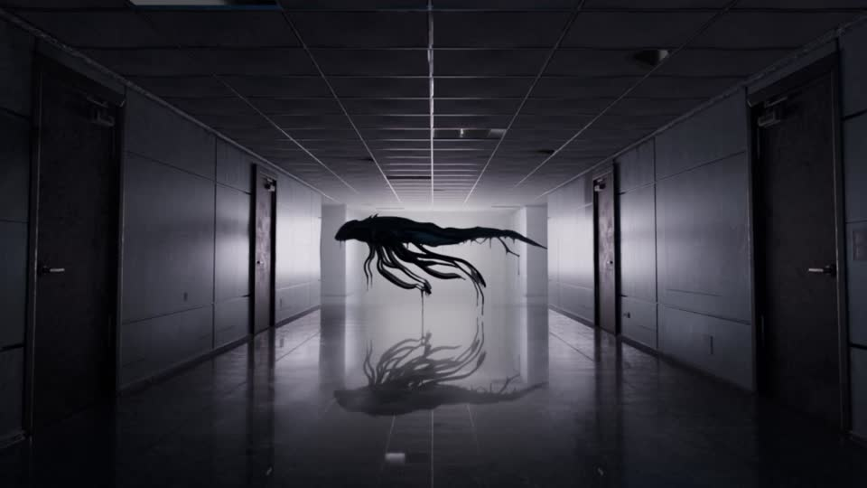</span>
            <span class="work-card__overlay"><span class="work-card__open">WATCH FILM <b>▷</b></span><span class="work-card__number">01</span></span>
          </button>
          <div class="work-card__caption"><div><p class="eyebrow">AUDIOVISUAL / BLENDER × TD</p><h3>REVENANT</h3></div><span class="work-card__category">01:50 · PROJECT FILE</span></div>
        </article>

        <article class="work-card work-card--portrait" data-categories="3d" data-project="nyarlathotep">
          <button class="work-card__button" type="button" aria-label="Nyarlathotep 조형 작업 상세 보기">
            <span class="work-card__image">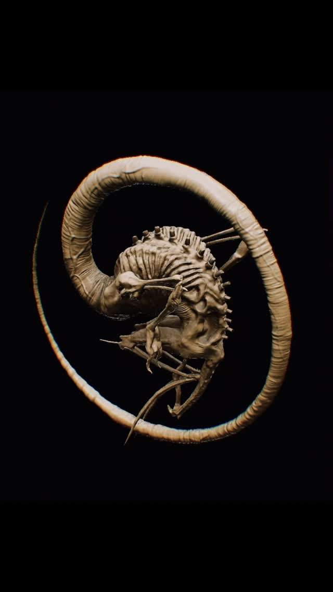</span>
            <span class="work-card__overlay"><span class="work-card__open">EXPLORE 3D <b>↗</b></span><span class="work-card__number">02</span></span>
          </button>
          <div class="work-card__caption"><div><p class="eyebrow">SCULPTURE / NOMAD SCULPT</p><h3>NYARLATHOTEP</h3></div><span class="work-card__category">3D</span></div>
        </article>

        <article class="work-card work-card--portrait work-card--heavener" data-categories="ai touchdesigner" data-project="heavener">
          <button class="work-card__button" type="button" aria-label="Heavener AI 및 TouchDesigner 작업 상세 보기">
            <span class="work-card__image">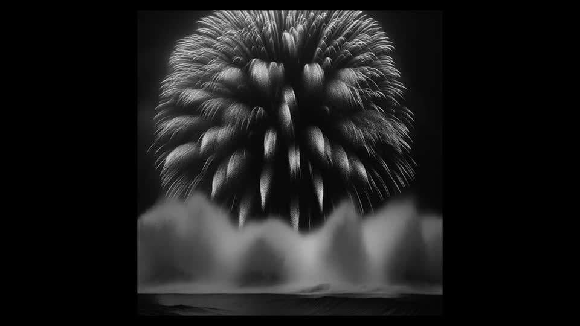</span>
            <span class="work-card__overlay"><span class="work-card__open">WATCH FILM <b>▷</b></span><span class="work-card__number">03</span></span>
          </button>
          <div class="work-card__caption"><div><p class="eyebrow">IMAGE / FIREFLY × TD</p><h3>HEAVENER</h3></div><span class="work-card__category">AI · TOUCHDESIGNER</span></div>
        </article>

        <article class="work-card work-card--wide" data-categories="3d" data-project="unreal">
          <button class="work-card__button" type="button" aria-label="Unreal Engine 5 시퀀스 작업 상세 보기">
            <span class="work-card__image">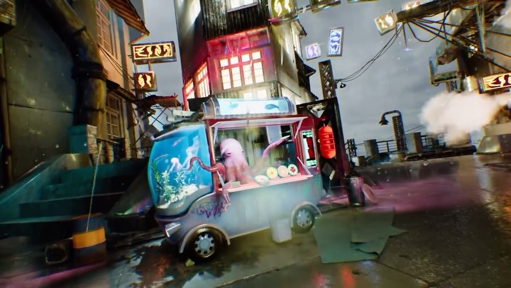</span>
            <span class="work-card__overlay"><span class="work-card__open">VIEW STUDY <b>↗</b></span><span class="work-card__number">04</span></span>
          </button>
          <div class="work-card__caption"><div><p class="eyebrow">CINEMATIC / MAYA → UE5</p><h3>SEQUENCE STUDY</h3></div><span class="work-card__category">3D · UNREAL ENGINE</span></div>
        </article>

        <article class="work-card" data-categories="3d" data-project="station">
          <button class="work-card__button" type="button" aria-label="Shinjuku 환경 스터디 상세 보기">
            <span class="work-card__image">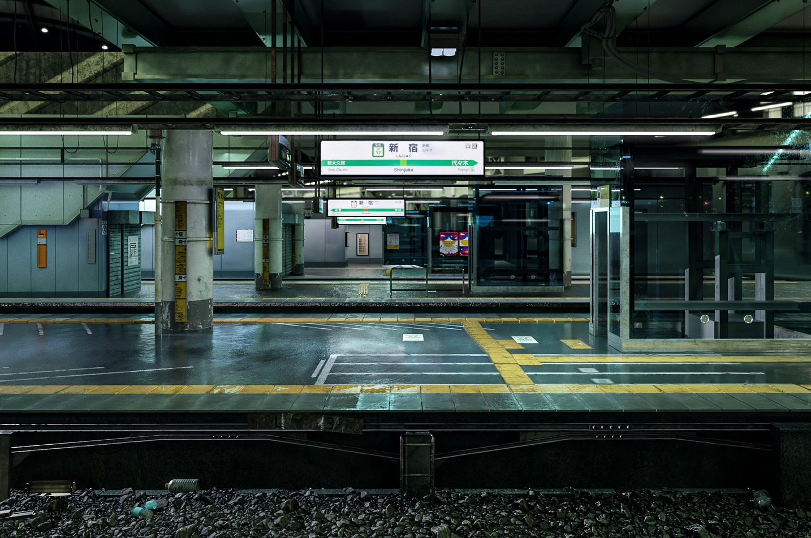</span>
            <span class="work-card__overlay"><span class="work-card__open">VIEW STUDY <b>↗</b></span><span class="work-card__number">05</span></span>
          </button>
          <div class="work-card__caption"><div><p class="eyebrow">ENVIRONMENT / STUDY</p><h3>SHINJUKU, AFTER HOURS</h3></div><span class="work-card__category">3D</span></div>
        </article>

        <article class="work-card" data-categories="3d" data-project="lantern">
          <button class="work-card__button" type="button" aria-label="Industrial lantern 오브젝트 스터디 상세 보기">
            <span class="work-card__image">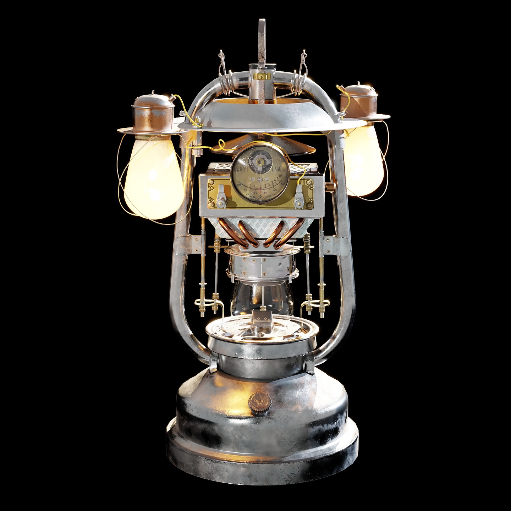</span>
            <span class="work-card__overlay"><span class="work-card__open">EXPLORE 3D <b>↗</b></span><span class="work-card__number">06</span></span>
          </button>
          <div class="work-card__caption"><div><p class="eyebrow">OBJECT / MATERIAL STUDY</p><h3>FIELD LAMP</h3></div><span class="work-card__category">3D</span></div>
        </article>
        <article class="work-card work-card--wide" data-categories="touchdesigner 3d" data-project="ritual">
          <button class="work-card__button" type="button" aria-label="Ritual 영상 재생 및 작업 상세 보기">
            <span class="work-card__image">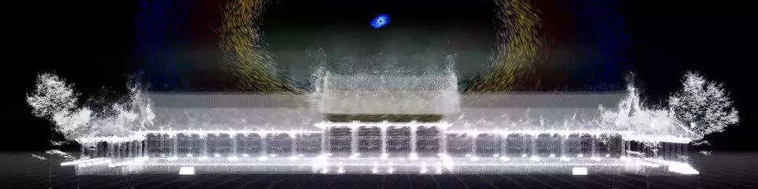</span>
            <span class="work-card__overlay"><span class="work-card__open">WATCH FILM <b>▷</b></span><span class="work-card__number">07</span></span>
          </button>
          <div class="work-card__caption"><div><p class="eyebrow">AUDIOVISUAL / FILM</p><h3>RITUAL</h3></div><span class="work-card__category">01:50 · VIDEO</span></div>
        </article>
        <article class="work-card" data-categories="motion" data-project="mo">
          <button class="work-card__button" type="button" aria-label="mo 영상 보기">
            <span class="work-card__image"></span>
            <span class="work-card__overlay"><span class="work-card__open">WATCH FILM <b>▷</b></span><span class="work-card__number">08</span></span>
          </button>
          <div class="work-card__caption"><div><p class="eyebrow">MOTION / VIDEO STUDY</p><h3>mo</h3></div><span class="work-card__category">03:02 · SILENT</span></div>
        </article>
        <article class="work-card" data-categories="3d" data-project="foodtruck">
          <button class="work-card__button" type="button" aria-label="Neo Tokyo Food Truck 3D 작업 보기">
            <span class="work-card__image">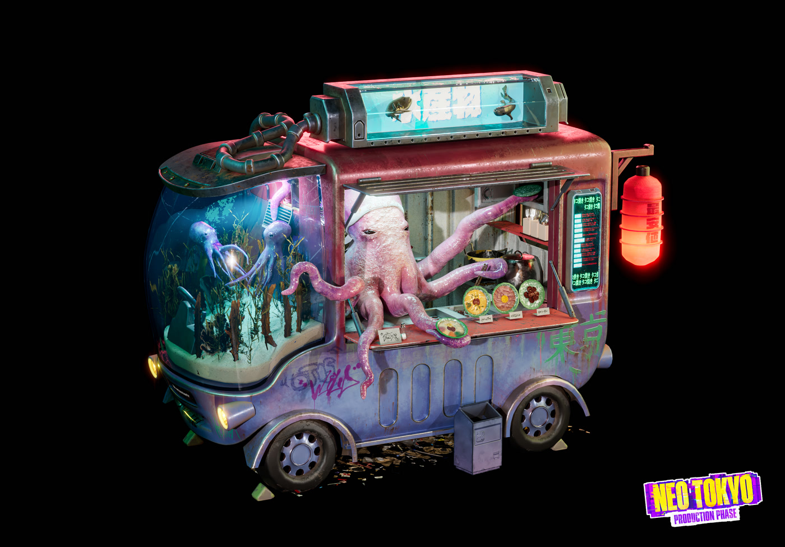</span>
            <span class="work-card__overlay"><span class="work-card__open">VIEW 360° <b>▷</b></span></span>
          </button>
          <div class="work-card__caption"><div><p class="eyebrow">MAYA / VEHICLE & ENVIRONMENT</p><h3>NEO TOKYO FOOD TRUCK</h3></div><span class="work-card__category">3D</span></div>
        </article>
        <article class="work-card" data-categories="3d" data-project="classroom">
          <button class="work-card__button" type="button" aria-label="Classroom 3D 조명 작업 보기">
            <span class="work-card__image">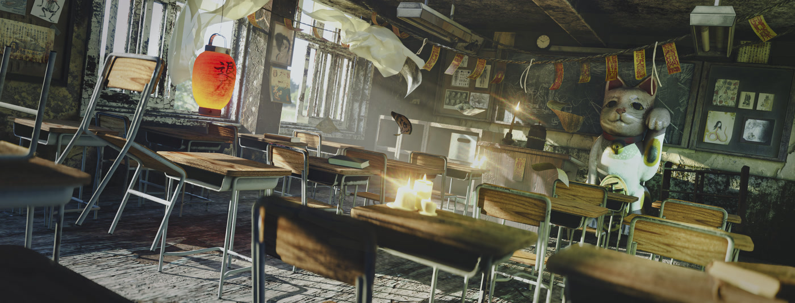</span>
            <span class="work-card__overlay"><span class="work-card__open">VIEW STUDY <b>↗</b></span></span>
          </button>
          <div class="work-card__caption"><div><p class="eyebrow">MAYA / LIGHTING STUDY</p><h3>CLASSROOM</h3></div><span class="work-card__category">3D</span></div>
        </article>
        <article class="work-card" data-categories="3d" data-project="keychain">
          <button class="work-card__button" type="button" aria-label="Keychain 3D 모델과 렌더 보기">
            <span class="work-card__image">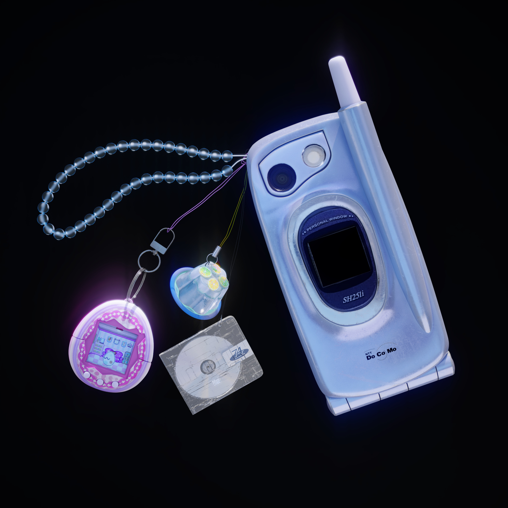</span>
            <span class="work-card__overlay"><span class="work-card__open">EXPLORE 3D <b>↗</b></span></span>
          </button>
          <div class="work-card__caption"><div><p class="eyebrow">MAYA / PROP DESIGN</p><h3>KEYCHAIN</h3></div><span class="work-card__category">3D</span></div>
        </article>
        <article class="work-card" data-categories="3d" data-project="game-controller">
          <button class="work-card__button" type="button" aria-label="Game Controller 3D 모델과 렌더 보기">
            <span class="work-card__image">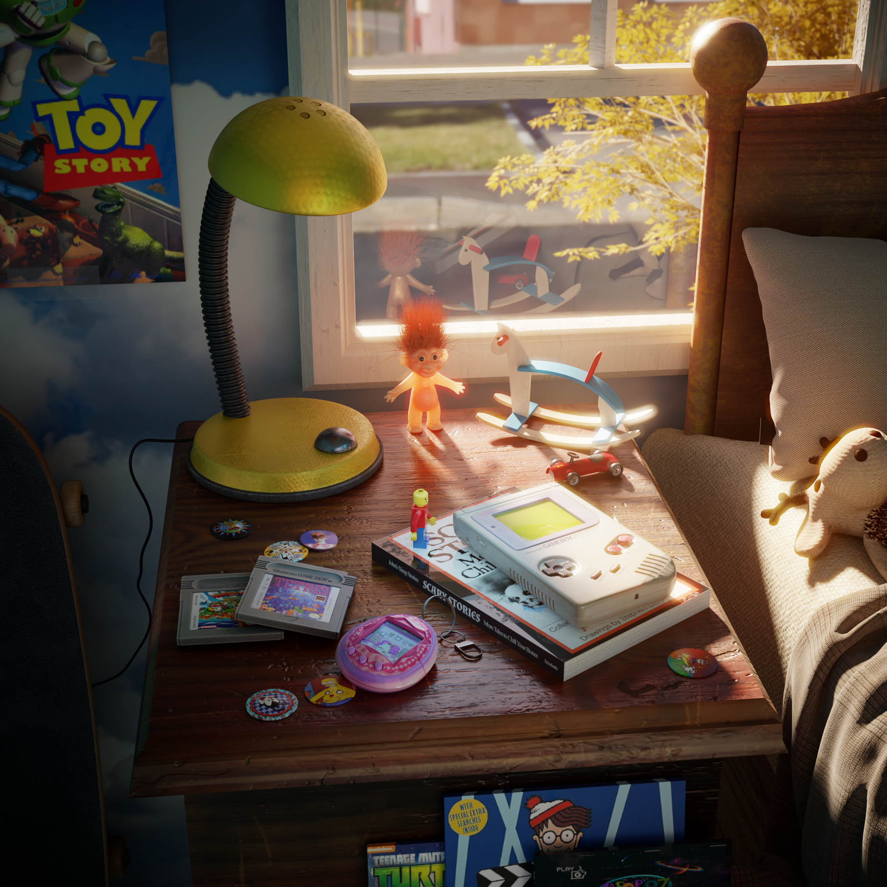</span>
            <span class="work-card__overlay"><span class="work-card__open">EXPLORE 3D <b>↗</b></span></span>
          </button>
          <div class="work-card__caption"><div><p class="eyebrow">MAYA / ENVIRONMENT &amp; PROPS</p><h3>GAME CONTROLLER</h3></div><span class="work-card__category">3D</span></div>
        </article>
        <article class="work-card" data-categories="3d" data-project="jonglu">
          <button class="work-card__button" type="button" aria-label="Jonglu 종루 3D 모델과 렌더 보기">
            <span class="work-card__image">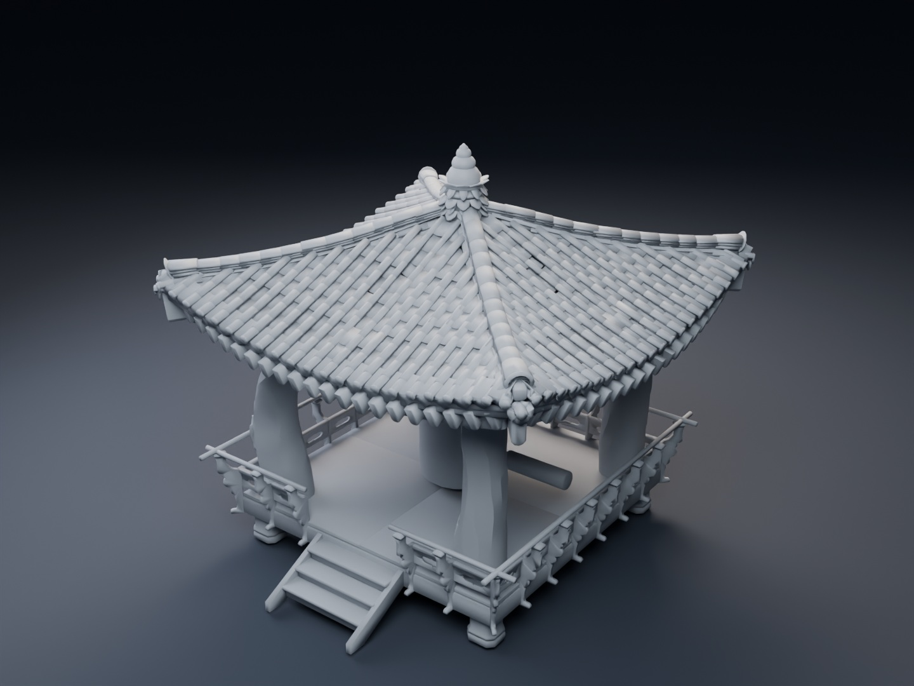</span>
            <span class="work-card__overlay"><span class="work-card__open">EXPLORE 3D <b>↗</b></span></span>
          </button>
          <div class="work-card__caption"><div><p class="eyebrow">MAYA / ARCHITECTURAL MODELING</p><h3>JONGLU</h3></div><span class="work-card__category">3D</span></div>
        </article>
        <article class="work-card" data-categories="3d" data-project="guitar">
          <button class="work-card__button" type="button" aria-label="Guitar 클레이 스터디 3D 모델과 렌더 보기">
            <span class="work-card__image"></span>
            <span class="work-card__overlay"><span class="work-card__open">EXPLORE 3D <b>↗</b></span></span>
          </button>
          <div class="work-card__caption"><div><p class="eyebrow">MAYA / HARD-SURFACE MODELING</p><h3>GUITAR · CLAY STUDY</h3></div><span class="work-card__category">3D</span></div>
        </article>
      </div>
    </section>

    <footer class="site-footer">
      <a class="footer-brand" href="index.html">Kakee<span> / VISUAL RESEARCHER</span></a>
      <p>장면을 만들고, 그 빛을 움직여 봅니다.</p>
      <div class="footer-links"><a href="https://www.instagram.com/kakeekukeko/" target="_blank" rel="noreferrer">INSTAGRAM ↗</a><button type="button" data-open-contact>CONTACT ↗</button><span>© 2026</span></div>
    </footer>
  </main>

  <dialog class="project-dialog" id="projectDialog" aria-labelledby="projectTitle">
    <div class="dialog-frame">
      <button class="dialog-close" type="button" data-close-dialog aria-label="상세 창 닫기">×</button>
      <p class="eyebrow" id="projectEyebrow"></p>
      <h2 id="projectTitle"></h2>
      <div class="project-viewport" id="projectViewport" hidden>
        <div class="viewport-stage" id="viewportStage"></div>
        <div class="viewport-controls">
          <span>드래그해서 회전 · 휠이나 두 손가락으로 확대</span>
          <div class="viewport-modes" role="group" aria-label="3D 표시 방식">
            <button type="button" data-viewport-mode="clay" aria-pressed="true" disabled>Clay</button>
            <button type="button" data-viewport-mode="wire" aria-pressed="false" disabled>Wire</button>
          </div>
          <button type="button" id="viewportReset" disabled>시점 초기화</button>
        </div>
        <p id="viewportStatus" role="status"></p>
      </div>
      <div class="project-media" id="projectMedia"></div>
      <p class="dialog-copy" id="projectCopy"></p>
      <div class="dialog-tools" id="projectTools"></div>
      <div class="project-files" id="projectFiles"></div>
      <a class="dialog-source" id="projectSource" href="#" target="_blank" rel="noreferrer">원본 게시물 보기 <span>↗</span></a>
    </div>
  </dialog>

  <dialog class="contact-dialog" id="contactDialog" aria-labelledby="contactTitle">
    <div class="dialog-frame contact-frame">
      <button class="dialog-close" type="button" data-close-dialog aria-label="연락 창 닫기">×</button>
      <p class="eyebrow">OPEN FOR SELECT PROJECTS</p>
      <h2 id="contactTitle">함께 만들어 볼까요?</h2>
      <p class="dialog-copy">프로젝트, 협업, 혹은 흥미로운 아이디어가 있다면 편하게 연락 주세요.</p>
      <a class="contact-email" href="mailto:sfinert@gmail.com">sfinert@gmail.com <span>↗</span></a>
      <button class="copy-email" id="copyEmail" type="button">이메일 주소 복사</button>
      <span class="copy-feedback" id="copyFeedback" aria-live="polite"></span>
    </div>
  </dialog>

  <script type="module" src="main.js"></script>
  <script type="module" src="works-ribbon.js"></script>
</body>
</html>
````

## public/OPEN-PORTFOLIO.html

````
<!doctype html>
<html lang="ko">
<head>
  <meta charset="UTF-8">
  <meta name="viewport" content="width=device-width, initial-scale=1, viewport-fit=cover">
  <meta name="description" content="Kakee · So Yeon Kim. 공간과 캐릭터, 움직이는 이미지를 만드는 3D &amp; Moving Image Artist.">
  <meta name="theme-color" content="#050505">
  <meta property="og:title" content="Kakee — 3D · Motion · Interactive">
  <meta property="og:description" content="이미지와 3D 장면을 인터랙티브한 움직임으로 확장합니다.">
  <meta property="og:image" content="media/works/revenant-poster.jpg">
  <title>Kakee — 3D · Motion · Interactive</title>
  <link rel="icon" href="mark.svg" type="image/svg+xml">
  <link rel="preload" as="image" href="media/works/revenant-poster.jpg" fetchpriority="high">
  <link rel="stylesheet" href="style.css">
  <link rel="stylesheet" href="hero.css">
  <link rel="stylesheet" href="about.css">
  <script src="assets/revenant-hero-data.js" defer></script>
</head>
<body class="home-page">
  <header class="site-header">
    <a class="brand" href="#top" aria-label="Kakee 홈">
      <svg class="brand-mark" viewBox="0 0 40 40" fill="none" aria-hidden="true">
        <circle cx="20" cy="20" r="18.5" stroke="currentColor" stroke-width="1.35"/>
        <path d="M20 6.8 22.4 14.2 29.3 10.7 25.8 17.6 33.2 20 25.8 22.4 29.3 29.3 22.4 25.8 20 33.2 17.6 25.8 10.7 29.3 14.2 22.4 6.8 20 14.2 17.6 10.7 10.7 17.6 14.2Z" fill="currentColor"/>
      </svg>
      <span class="brand-copy"><strong>Kakee</strong><small>3D / MOTION / INTERACTIVE</small></span>
    </a>
    <nav class="top-nav" aria-label="주요 메뉴">
      <a href="OPEN-WORKS.html" class="nav-work">Work</a>
      <a href="#about">About</a>
      <button class="contact-trigger" type="button" data-open-contact>Let’s talk</button>
    </nav>
  </header>

  <main class="site-shell" id="top">
    <section class="hero" aria-labelledby="hero-title">
      <div class="hero__stage">
        <div class="hero__frame">
          <video id="heroVideo" class="hero__video" src="media/works/revenant.mp4" poster="media/works/revenant-poster.jpg" loop playsinline preload="auto" aria-label="Loathe — Revenant 영상"></video>
          <canvas id="heroField" class="hero__field" aria-hidden="true" hidden></canvas>
        </div>
        <div class="hero__footer">
          <h1 class="hero__credit" id="hero-title">Loathe <span>—</span> Revenant</h1>
          <span class="hero__scroll" aria-hidden="true">Scroll to enter <span>↓</span></span>
          <div class="hero__controls">
            <button class="hero__play" type="button" aria-label="재생" title="재생">
              <svg viewBox="0 0 24 24" fill="none" stroke="currentColor" stroke-width="1.5" stroke-linecap="round" stroke-linejoin="round" aria-hidden="true"><path class="icon-play" d="m9 5 10 7-10 7Z"/><path class="icon-pause" d="M9 6v12m6-12v12"/></svg>
            </button>
            <button class="hero__sound" type="button" aria-label="소리 켜기" title="소리 켜기">
              <svg viewBox="0 0 24 24" fill="none" stroke="currentColor" stroke-width="1.5" stroke-linecap="round" stroke-linejoin="round" aria-hidden="true"><path d="M4 10h4l5-4v12l-5-4H4z"/><path class="icon-wave" d="M16 9a4 4 0 0 1 0 6m2-8a7 7 0 0 1 0 10"/><path class="icon-muted" d="m16.5 10 4 4m0-4-4 4"/></svg>
            </button>
          </div>
        </div>
      </div>
      <section class="about-section about-studio" id="about" aria-labelledby="about-title">
        <div class="about-content">
          <h2 id="about-title">Kakee</h2>
          <p class="about-name">So Yeon Kim</p>
          <p class="about-tagline">Worlds with a pulse.</p>
          <p class="about-role">3D &amp; Moving Image Artist</p>
          <p class="about-copy">공간과 캐릭터, 움직이는 이미지를 만듭니다. 회화에서 익힌 색과 구도, 심리학에 대한 관심에서 출발해 낯선 세계가 어떤 감각으로 남는지 탐구합니다.</p>
          <p class="about-process">3D로 장면을 만들고, TouchDesigner로 빛과 소리의 리듬을 엮습니다. 필요할 때는 AI로 이미지와 움직임의 가능성을 실험합니다.</p>
          <div class="about-actions">
            <a class="about-work" href="OPEN-WORKS.html">작업 보기</a>
            <button class="about-collab" type="button" data-open-contact>함께 작업하기</button>
          </div>
        </div>
      </section>
    </section>

    <footer class="site-footer">
      <a class="footer-brand" href="#top">Kakee<span> / VISUAL RESEARCHER</span></a>
      <p>장면을 만들고, 그 빛을 움직여 봅니다.</p>
      <div class="footer-links"><a href="https://www.instagram.com/kakeekukeko/" target="_blank" rel="noreferrer">INSTAGRAM ↗</a><button type="button" data-open-contact>CONTACT ↗</button><span>© 2026</span></div>
    </footer>
  </main>

  <dialog class="contact-dialog" id="contactDialog" aria-labelledby="contactTitle">
    <div class="dialog-frame contact-frame">
      <button class="dialog-close" type="button" data-close-dialog aria-label="연락 창 닫기">×</button>
      <p class="eyebrow">OPEN FOR SELECT PROJECTS</p>
      <h2 id="contactTitle">함께 만들어 볼까요?</h2>
      <p class="dialog-copy">프로젝트, 협업, 혹은 흥미로운 아이디어가 있다면 편하게 연락 주세요.</p>
      <a class="contact-email" href="mailto:sfinert@gmail.com">sfinert@gmail.com <span>↗</span></a>
      <button class="copy-email" id="copyEmail" type="button">이메일 주소 복사</button>
      <span class="copy-feedback" id="copyFeedback" aria-live="polite"></span>
    </div>
  </dialog>
  <script defer src="app-local.js"></script>
</body>
</html>
````

## public/OPEN-WORKS.html

````
<!doctype html>
<html lang="ko">
<head>
  <meta charset="UTF-8">
  <meta name="viewport" content="width=device-width, initial-scale=1, viewport-fit=cover">
  <meta name="theme-color" content="#050505">
  <meta name="description" content="Kakee의 3D, 모션, 인터랙티브 작품을 모아 보는 작업 아카이브.">
  <title>Work — Kakee</title>
  <link rel="icon" href="mark.svg" type="image/svg+xml">
  <link rel="stylesheet" href="style.css">
  <link rel="stylesheet" href="hero.css">
  <link rel="stylesheet" href="works-ribbon.css">
</head>
<body>
  <header class="site-header">
    <a class="brand" href="OPEN-PORTFOLIO.html" aria-label="Kakee 홈">
      <svg class="brand-mark" viewBox="0 0 40 40" fill="none" aria-hidden="true">
        <circle cx="20" cy="20" r="18.5" stroke="currentColor" stroke-width="1.35"/>
        <path d="M20 6.8 22.4 14.2 29.3 10.7 25.8 17.6 33.2 20 25.8 22.4 29.3 29.3 22.4 25.8 20 33.2 17.6 25.8 10.7 29.3 14.2 22.4 6.8 20 14.2 17.6 10.7 10.7 17.6 14.2Z" fill="currentColor"/>
      </svg>
      <span class="brand-copy"><strong>Kakee</strong><small>3D / MOTION / INTERACTIVE</small></span>
    </a>
    <nav class="top-nav" aria-label="주요 메뉴">
      <a href="OPEN-WORKS.html" class="nav-work" aria-current="page">Work</a>
      <a href="OPEN-PORTFOLIO.html#about">About</a>
      <button class="contact-trigger" type="button" data-open-contact>Let’s talk</button>
    </nav>
  </header>
  <main class="site-shell" id="top">
    <section class="works-ribbon" aria-labelledby="ribbon-title">
      <div class="ribbon-heading">
        <h1 id="ribbon-title">Selected<br>work.</h1>
        <a href="#work" class="ribbon-grid-link">전체 작업</a>
      </div>
      <div class="ribbon-stage" tabindex="0" aria-label="작품 미리보기">
        <div id="ribbonTrack" class="ribbon-track"></div>
      </div>
      <div class="ribbon-controls">
        <button type="button" data-ribbon-step="-1" aria-label="이전 작품">←</button>
        <p id="ribbonStatus" aria-live="polite"></p>
        <button type="button" data-ribbon-step="1" aria-label="다음 작품">→</button>
      </div>
    </section>
    <section class="work-section" id="work" aria-labelledby="work-title">
      <span id="work-3d" class="work-category-target" aria-hidden="true"></span>
      <span id="work-ai" class="work-category-target" aria-hidden="true"></span>
      <span id="work-touchdesigner" class="work-category-target" aria-hidden="true"></span>
      <nav class="work-categories" aria-label="작업 분야">
        <a class="work-category-link" href="#work" aria-current="true" aria-controls="workGrid" data-filter="all" data-category-title="전체 작업">
          <span>전체</span><span class="work-category-count" aria-hidden="true"></span>
        </a>
        <a class="work-category-link" href="#work-3d" aria-controls="workGrid" data-filter="3d" data-category-title="3D 작업">
          <span>3D</span><span class="work-category-count" aria-hidden="true"></span>
        </a>
        <a class="work-category-link" href="#work-ai" aria-controls="workGrid" data-filter="ai" data-category-title="AI 작업">
          <span>AI</span><span class="work-category-count" aria-hidden="true"></span>
        </a>
        <a class="work-category-link" href="#work-touchdesigner" aria-controls="workGrid" data-filter="touchdesigner" data-category-title="TouchDesigner 작업">
          <span>TouchDesigner</span><span class="work-category-count" aria-hidden="true"></span>
        </a>
      </nav>
      <div class="section-heading work-results-heading">
        <h2 id="work-title">전체 작업</h2>
        <span class="work-count" aria-live="polite"></span>
      </div>

      <div class="work-grid" id="workGrid">
        <article class="work-card work-card--wide" data-categories="touchdesigner 3d" data-project="revenant">
          <button class="work-card__button" type="button" aria-label="Revenant 영상 및 TouchDesigner 프로젝트 보기">
            <span class="work-card__image"></span>
            <span class="work-card__overlay"><span class="work-card__open">WATCH FILM <b>▷</b></span><span class="work-card__number">01</span></span>
          </button>
          <div class="work-card__caption"><div><p class="eyebrow">AUDIOVISUAL / BLENDER × TD</p><h3>REVENANT</h3></div><span class="work-card__category">01:50 · PROJECT FILE</span></div>
        </article>

        <article class="work-card work-card--portrait" data-categories="3d" data-project="nyarlathotep">
          <button class="work-card__button" type="button" aria-label="Nyarlathotep 조형 작업 상세 보기">
            <span class="work-card__image"></span>
            <span class="work-card__overlay"><span class="work-card__open">EXPLORE 3D <b>↗</b></span><span class="work-card__number">02</span></span>
          </button>
          <div class="work-card__caption"><div><p class="eyebrow">SCULPTURE / NOMAD SCULPT</p><h3>NYARLATHOTEP</h3></div><span class="work-card__category">3D</span></div>
        </article>

        <article class="work-card work-card--portrait work-card--heavener" data-categories="ai touchdesigner" data-project="heavener">
          <button class="work-card__button" type="button" aria-label="Heavener AI 및 TouchDesigner 작업 상세 보기">
            <span class="work-card__image"></span>
            <span class="work-card__overlay"><span class="work-card__open">WATCH FILM <b>▷</b></span><span class="work-card__number">03</span></span>
          </button>
          <div class="work-card__caption"><div><p class="eyebrow">IMAGE / FIREFLY × TD</p><h3>HEAVENER</h3></div><span class="work-card__category">AI · TOUCHDESIGNER</span></div>
        </article>

        <article class="work-card work-card--wide" data-categories="3d" data-project="unreal">
          <button class="work-card__button" type="button" aria-label="Unreal Engine 5 시퀀스 작업 상세 보기">
            <span class="work-card__image"></span>
            <span class="work-card__overlay"><span class="work-card__open">VIEW STUDY <b>↗</b></span><span class="work-card__number">04</span></span>
          </button>
          <div class="work-card__caption"><div><p class="eyebrow">CINEMATIC / MAYA → UE5</p><h3>SEQUENCE STUDY</h3></div><span class="work-card__category">3D · UNREAL ENGINE</span></div>
        </article>

        <article class="work-card" data-categories="3d" data-project="station">
          <button class="work-card__button" type="button" aria-label="Shinjuku 환경 스터디 상세 보기">
            <span class="work-card__image"></span>
            <span class="work-card__overlay"><span class="work-card__open">VIEW STUDY <b>↗</b></span><span class="work-card__number">05</span></span>
          </button>
          <div class="work-card__caption"><div><p class="eyebrow">ENVIRONMENT / STUDY</p><h3>SHINJUKU, AFTER HOURS</h3></div><span class="work-card__category">3D</span></div>
        </article>

        <article class="work-card" data-categories="3d" data-project="lantern">
          <button class="work-card__button" type="button" aria-label="Industrial lantern 오브젝트 스터디 상세 보기">
            <span class="work-card__image"></span>
            <span class="work-card__overlay"><span class="work-card__open">EXPLORE 3D <b>↗</b></span><span class="work-card__number">06</span></span>
          </button>
          <div class="work-card__caption"><div><p class="eyebrow">OBJECT / MATERIAL STUDY</p><h3>FIELD LAMP</h3></div><span class="work-card__category">3D</span></div>
        </article>
        <article class="work-card work-card--wide" data-categories="touchdesigner 3d" data-project="ritual">
          <button class="work-card__button" type="button" aria-label="Ritual 영상 재생 및 작업 상세 보기">
            <span class="work-card__image"></span>
            <span class="work-card__overlay"><span class="work-card__open">WATCH FILM <b>▷</b></span><span class="work-card__number">07</span></span>
          </button>
          <div class="work-card__caption"><div><p class="eyebrow">AUDIOVISUAL / FILM</p><h3>RITUAL</h3></div><span class="work-card__category">01:50 · VIDEO</span></div>
        </article>
        <article class="work-card" data-categories="motion" data-project="mo">
          <button class="work-card__button" type="button" aria-label="mo 영상 보기">
            <span class="work-card__image"></span>
            <span class="work-card__overlay"><span class="work-card__open">WATCH FILM <b>▷</b></span><span class="work-card__number">08</span></span>
          </button>
          <div class="work-card__caption"><div><p class="eyebrow">MOTION / VIDEO STUDY</p><h3>mo</h3></div><span class="work-card__category">03:02 · SILENT</span></div>
        </article>
        <article class="work-card" data-categories="3d" data-project="foodtruck">
          <button class="work-card__button" type="button" aria-label="Neo Tokyo Food Truck 3D 작업 보기">
            <span class="work-card__image"></span>
            <span class="work-card__overlay"><span class="work-card__open">VIEW 360° <b>▷</b></span></span>
          </button>
          <div class="work-card__caption"><div><p class="eyebrow">MAYA / VEHICLE & ENVIRONMENT</p><h3>NEO TOKYO FOOD TRUCK</h3></div><span class="work-card__category">3D</span></div>
        </article>
        <article class="work-card" data-categories="3d" data-project="classroom">
          <button class="work-card__button" type="button" aria-label="Classroom 3D 조명 작업 보기">
            <span class="work-card__image"></span>
            <span class="work-card__overlay"><span class="work-card__open">VIEW STUDY <b>↗</b></span></span>
          </button>
          <div class="work-card__caption"><div><p class="eyebrow">MAYA / LIGHTING STUDY</p><h3>CLASSROOM</h3></div><span class="work-card__category">3D</span></div>
        </article>
        <article class="work-card" data-categories="3d" data-project="keychain">
          <button class="work-card__button" type="button" aria-label="Keychain 3D 모델과 렌더 보기">
            <span class="work-card__image"></span>
            <span class="work-card__overlay"><span class="work-card__open">EXPLORE 3D <b>↗</b></span></span>
          </button>
          <div class="work-card__caption"><div><p class="eyebrow">MAYA / PROP DESIGN</p><h3>KEYCHAIN</h3></div><span class="work-card__category">3D</span></div>
        </article>
        <article class="work-card" data-categories="3d" data-project="game-controller">
          <button class="work-card__button" type="button" aria-label="Game Controller 3D 모델과 렌더 보기">
            <span class="work-card__image"></span>
            <span class="work-card__overlay"><span class="work-card__open">EXPLORE 3D <b>↗</b></span></span>
          </button>
          <div class="work-card__caption"><div><p class="eyebrow">MAYA / ENVIRONMENT &amp; PROPS</p><h3>GAME CONTROLLER</h3></div><span class="work-card__category">3D</span></div>
        </article>
        <article class="work-card" data-categories="3d" data-project="jonglu">
          <button class="work-card__button" type="button" aria-label="Jonglu 종루 3D 모델과 렌더 보기">
            <span class="work-card__image"></span>
            <span class="work-card__overlay"><span class="work-card__open">EXPLORE 3D <b>↗</b></span></span>
          </button>
          <div class="work-card__caption"><div><p class="eyebrow">MAYA / ARCHITECTURAL MODELING</p><h3>JONGLU</h3></div><span class="work-card__category">3D</span></div>
        </article>
        <article class="work-card" data-categories="3d" data-project="guitar">
          <button class="work-card__button" type="button" aria-label="Guitar 클레이 스터디 3D 모델과 렌더 보기">
            <span class="work-card__image"></span>
            <span class="work-card__overlay"><span class="work-card__open">EXPLORE 3D <b>↗</b></span></span>
          </button>
          <div class="work-card__caption"><div><p class="eyebrow">MAYA / HARD-SURFACE MODELING</p><h3>GUITAR · CLAY STUDY</h3></div><span class="work-card__category">3D</span></div>
        </article>
      </div>
    </section>

    <footer class="site-footer">
      <a class="footer-brand" href="OPEN-PORTFOLIO.html">Kakee<span> / VISUAL RESEARCHER</span></a>
      <p>장면을 만들고, 그 빛을 움직여 봅니다.</p>
      <div class="footer-links"><a href="https://www.instagram.com/kakeekukeko/" target="_blank" rel="noreferrer">INSTAGRAM ↗</a><button type="button" data-open-contact>CONTACT ↗</button><span>© 2026</span></div>
    </footer>
  </main>

  <dialog class="project-dialog" id="projectDialog" aria-labelledby="projectTitle">
    <div class="dialog-frame">
      <button class="dialog-close" type="button" data-close-dialog aria-label="상세 창 닫기">×</button>
      <p class="eyebrow" id="projectEyebrow"></p>
      <h2 id="projectTitle"></h2>
      <div class="project-viewport" id="projectViewport" hidden>
        <div class="viewport-stage" id="viewportStage"></div>
        <div class="viewport-controls">
          <span>드래그해서 회전 · 휠이나 두 손가락으로 확대</span>
          <div class="viewport-modes" role="group" aria-label="3D 표시 방식">
            <button type="button" data-viewport-mode="clay" aria-pressed="true" disabled>Clay</button>
            <button type="button" data-viewport-mode="wire" aria-pressed="false" disabled>Wire</button>
          </div>
          <button type="button" id="viewportReset" disabled>시점 초기화</button>
        </div>
        <p id="viewportStatus" role="status"></p>
      </div>
      <div class="project-media" id="projectMedia"></div>
      <p class="dialog-copy" id="projectCopy"></p>
      <div class="dialog-tools" id="projectTools"></div>
      <div class="project-files" id="projectFiles"></div>
      <a class="dialog-source" id="projectSource" href="#" target="_blank" rel="noreferrer">원본 게시물 보기 <span>↗</span></a>
    </div>
  </dialog>

  <dialog class="contact-dialog" id="contactDialog" aria-labelledby="contactTitle">
    <div class="dialog-frame contact-frame">
      <button class="dialog-close" type="button" data-close-dialog aria-label="연락 창 닫기">×</button>
      <p class="eyebrow">OPEN FOR SELECT PROJECTS</p>
      <h2 id="contactTitle">함께 만들어 볼까요?</h2>
      <p class="dialog-copy">프로젝트, 협업, 혹은 흥미로운 아이디어가 있다면 편하게 연락 주세요.</p>
      <a class="contact-email" href="mailto:sfinert@gmail.com">sfinert@gmail.com <span>↗</span></a>
      <button class="copy-email" id="copyEmail" type="button">이메일 주소 복사</button>
      <span class="copy-feedback" id="copyFeedback" aria-live="polite"></span>
    </div>
  </dialog>
  <script defer src="app-local.js"></script>
</body>
</html>
````

## public/style.css

````
@import url('https://fonts.googleapis.com/css2?family=DM+Mono:wght@400;500&family=Manrope:wght@400;500;600;700;800&display=swap');

:root {
  --bg: #050505;
  --panel: #0b0b0c;
  --text: #f2f0ed;
  --muted: #949397;
  --line: rgba(255, 255, 255, .16);
  --accent: #aa88ff;
  --accent-soft: rgba(170, 136, 255, .15);
  --mono: 'DM Mono', 'SF Mono', Menlo, Consolas, monospace;
  --sans: 'Manrope', 'Apple SD Gothic Neo', 'Noto Sans KR', sans-serif;
  color-scheme: dark;
  scroll-behavior: smooth;
}

* { box-sizing: border-box; }
html { min-width: 320px; background: var(--bg); scroll-behavior: smooth; }
body {
  min-width: 320px;
  margin: 0;
  overflow-x: hidden;
  background: var(--bg);
  color: var(--text);
  font: 400 15px/1.6 var(--sans);
  letter-spacing: -.015em;
  -webkit-font-smoothing: antialiased;
  text-rendering: optimizeLegibility;
}
button, a { color: inherit; font: inherit; }
a { text-decoration: none; }
button { border: 0; }
::selection { color: #08070b; background: var(--accent); }

.site-shell { position: relative; z-index: 1; isolation: isolate; }
.eyebrow, .filter-label, .filter-button span, .work-card__category, .work-card__open, .work-card__number, .footer-brand span, .footer-links, .dialog-source, .copy-email {
  font-family: var(--mono);
  font-size: 10px;
  font-weight: 400;
  letter-spacing: .055em;
  line-height: 1.45;
}
.eyebrow { margin: 0; color: var(--muted); text-transform: uppercase; }
.eyebrow > span:first-child { color: var(--accent); }

.site-header {
  position: fixed;
  z-index: 30;
  top: 0;
  left: 0;
  display: flex;
  width: 100%;
  height: 86px;
  align-items: center;
  justify-content: space-between;
  padding: 0 40px;
}
.site-header::before {
  position: absolute;
  z-index: -1;
  inset: 0 0 -42px;
  background: linear-gradient(180deg, rgba(5, 5, 5, .78), rgba(5, 5, 5, 0));
  content: '';
  pointer-events: none;
}
.brand { display: inline-flex; align-items: center; gap: 11px; }
.brand-mark { width: 37px; height: 37px; color: #fff; }
.brand-copy { display: flex; flex-direction: column; gap: 2px; }
.brand-copy strong { color: #fff; font: 500 14px/1.1 var(--mono); letter-spacing: .09em; }
.brand-copy small { color: rgba(255, 255, 255, .62); font: 400 8px/1.2 var(--mono); letter-spacing: .075em; }
.top-nav { display: flex; align-items: center; gap: clamp(22px, 3vw, 48px); }
.top-nav > a { color: rgba(255, 255, 255, .74); font-size: 12px; transition: color .2s ease; }
.top-nav > a:hover { color: #fff; }
.contact-trigger {
  display: inline-flex;
  min-height: 42px;
  align-items: center;
  gap: 14px;
  padding: 0 16px;
  border: 1px solid rgba(255, 255, 255, .42);
  border-radius: 999px;
  background: rgba(5, 5, 5, .38);
  color: #fff;
  cursor: pointer;
  font-size: 11px;
  transition: color .2s ease, border-color .2s ease, background .2s ease;
  backdrop-filter: blur(12px);
}
.contact-trigger:hover { border-color: var(--accent); background: rgba(170, 136, 255, .14); }

.section-heading h2 em { color: var(--accent); font-style: normal; }

.work-section {
  position: relative;
  padding: 142px max(40px, 7.6vw) 110px;
  border-top: 1px solid rgba(255, 255, 255, .09);
  background: linear-gradient(180deg, rgba(5, 5, 5, .91), rgba(5, 5, 5, .84) 75%, rgba(5, 5, 5, .93));
  scroll-margin-top: 70px;
}
.section-heading { display: flex; align-items: flex-end; justify-content: space-between; gap: 50px; margin-bottom: 52px; }
.section-index { margin-bottom: 22px; }
.section-heading h2 {
  margin: 0;
  color: var(--text);
  font-size: clamp(36px, 5.3vw, 76px);
  font-weight: 500;
  letter-spacing: -.075em;
  line-height: 1.08;
}
.section-note { max-width: 295px; margin: 0 0 6px; color: var(--muted); font-size: 13px; line-height: 1.75; }
.filter-bar { display: flex; min-height: 54px; align-items: center; gap: 8px; margin-bottom: 32px; border-top: 1px solid var(--line); border-bottom: 1px solid var(--line); }
.filter-label { margin-right: 10px; color: var(--muted); white-space: nowrap; }
.filter-button {
  display: inline-flex;
  min-height: 31px;
  align-items: center;
  gap: 8px;
  padding: 0 11px;
  border: 1px solid transparent;
  border-radius: 2px;
  background: transparent;
  color: rgba(255, 255, 255, .68);
  cursor: pointer;
  font-size: 11px;
  white-space: nowrap;
  transition: border-color .2s ease, background .2s ease, color .2s ease;
}
.filter-button span { color: rgba(255, 255, 255, .36); font-size: 8px; }
.filter-button:hover, .filter-button.is-active { border-color: rgba(170, 136, 255, .56); background: var(--accent-soft); color: #fff; }
.filter-button.is-active span { color: var(--accent); }
.work-count { margin-left: auto; color: var(--muted); font: 9px/1 var(--mono); white-space: nowrap; }
.work-grid { display: grid; grid-template-columns: repeat(12, minmax(0, 1fr)); align-items: start; column-gap: 24px; row-gap: 58px; }
.work-card { grid-column: span 6; min-width: 0; animation: card-in .45s ease both; }
.work-card--wide { grid-column: span 7; }
.work-card--portrait { grid-column: span 5; }
.work-card:nth-child(4n + 2), .work-card:nth-child(4n + 3) { margin-top: 75px; }
.work-card[hidden] { display: none; }
.work-card__button { position: relative; display: block; width: 100%; overflow: hidden; padding: 0; background: #0c0c0d; color: #fff; cursor: pointer; text-align: left; }
.work-card__image { position: relative; display: block; width: 100%; aspect-ratio: 1.34 / 1; overflow: hidden; background: #0b0b0d; }
.work-card--portrait .work-card__image { aspect-ratio: .94 / 1; }
.work-card--heavener .work-card__image { background: #20242a; }
.work-card__image::after { position: absolute; inset: 0; background: linear-gradient(180deg, rgba(0,0,0,.04), transparent 48%, rgba(0,0,0,.22)); content: ''; pointer-events: none; }
.work-card__image img { display: block; width: 100%; height: 100%; object-fit: cover; object-position: center; filter: saturate(.86); transition: transform .7s cubic-bezier(.2,.65,.3,1), filter .4s ease; }
.work-card--portrait .work-card__image img { object-position: center 45%; }
.work-card__overlay { position: absolute; inset: 0; display: flex; align-items: flex-end; justify-content: space-between; padding: 18px; background: linear-gradient(180deg, transparent 48%, rgba(0,0,0,.48)); opacity: .78; transition: opacity .25s ease; }
.work-card__open { color: #fff; }
.work-card__open b { margin-left: 12px; color: var(--accent); font-size: 14px; }
.work-card__number { color: rgba(255,255,255,.72); }
.work-card__button:hover .work-card__image img, .work-card__button:focus-visible .work-card__image img { transform: scale(1.035); filter: saturate(1.05); }
.work-card__button:hover .work-card__overlay, .work-card__button:focus-visible .work-card__overlay { opacity: 1; }
.work-card__caption { display: flex; align-items: flex-end; justify-content: space-between; gap: 14px; padding-top: 14px; }
.work-card__caption .eyebrow { margin-bottom: 5px; color: var(--muted); font-size: 9px; }
.work-card__caption h3 { margin: 0; color: #f3f1ee; font-size: clamp(17px, 1.65vw, 23px); font-weight: 500; letter-spacing: -.055em; line-height: 1.2; }
.work-card__category { padding-bottom: 2px; color: var(--accent); font-size: 8px; text-align: right; white-space: nowrap; }
.grid-end-note { display: flex; justify-content: space-between; margin: 64px 0 0; padding-top: 12px; border-top: 1px solid var(--line); color: var(--muted); font: 9px/1.5 var(--mono); letter-spacing: .06em; }
.grid-end-note span { color: rgba(170, 136, 255, .78); }
@keyframes card-in { from { opacity: 0; transform: translateY(10px); } to { opacity: 1; transform: translateY(0); } }

.site-footer { position: relative; display: flex; min-height: 112px; align-items: center; justify-content: space-between; gap: 24px; padding: 24px max(40px, 7.6vw); border-top: 1px solid var(--line); background: rgba(5,5,5,.94); }
.footer-brand { color: #fff; font: 500 12px/1 var(--mono); letter-spacing: .08em; white-space: nowrap; }
.footer-brand span { color: var(--muted); font-size: 8px; }
.site-footer > p { margin: 0; color: var(--muted); font-size: 12px; }
.footer-links { display: flex; align-items: center; gap: 20px; color: rgba(255,255,255,.65); font-size: 8px; }
.footer-links a:hover, .footer-links button:hover { color: var(--accent); }
.footer-links button { padding: 0; background: none; color: inherit; cursor: pointer; font: inherit; }

.project-dialog, .contact-dialog { width: min(620px, calc(100vw - 30px)); max-width: none; padding: 0; overflow: visible; border: 1px solid rgba(255,255,255,.23); background: #101012; color: var(--text); box-shadow: 0 24px 120px rgba(0,0,0,.72); }
.project-dialog::backdrop, .contact-dialog::backdrop { background: rgba(0,0,0,.72); backdrop-filter: blur(9px); }
.dialog-frame { position: relative; padding: clamp(30px, 5vw, 54px); }
.dialog-close { position: absolute; top: 18px; right: 18px; display: grid; width: 36px; height: 36px; place-items: center; border: 1px solid rgba(255,255,255,.2); border-radius: 50%; background: transparent; color: #fff; cursor: pointer; font-size: 21px; line-height: 1; }
.dialog-close:hover { border-color: var(--accent); color: var(--accent); }
.dialog-frame > .eyebrow { margin-bottom: 18px; color: var(--accent); }
.dialog-frame h2 { max-width: 490px; margin: 0 38px 20px 0; font-size: clamp(32px, 6vw, 55px); font-weight: 500; letter-spacing: -.065em; line-height: 1.08; }
.dialog-copy { margin: 0; color: rgba(242,240,237,.76); font-size: 15px; line-height: 1.9; }
.dialog-tools { display: flex; flex-wrap: wrap; gap: 8px; margin-top: 24px; }
.dialog-tools span { padding: 7px 9px; border: 1px solid rgba(255,255,255,.16); color: var(--muted); font: 9px/1.2 var(--mono); }
.dialog-source { display: inline-flex; gap: 16px; margin-top: 34px; padding-bottom: 6px; border-bottom: 1px solid rgba(255,255,255,.35); color: #fff; }
.dialog-source span { color: var(--accent); }
.contact-frame h2 { font-size: clamp(30px, 5.5vw, 48px); }
.contact-email { display: inline-flex; align-items: center; gap: 14px; margin-top: 28px; color: #fff; font: 500 clamp(18px, 4vw, 26px)/1.4 var(--mono); letter-spacing: -.04em; }
.contact-email span { color: var(--accent); font-size: 17px; }
.copy-email { display: block; margin-top: 16px; padding: 8px 0; border-bottom: 1px solid rgba(255,255,255,.22); background: transparent; color: rgba(255,255,255,.65); cursor: pointer; }
.copy-email:hover { color: #fff; border-color: var(--accent); }
.copy-feedback { display: block; min-height: 18px; margin-top: 7px; color: var(--accent); font: 9px/1.4 var(--mono); }

.project-media:empty { display: none; }
.project-dialog { max-height: 90svh; overflow-y: auto; overscroll-behavior: contain; }
.project-media figure { margin: 22px 0; }
.project-media figcaption { margin-bottom: 9px; color: var(--accent); font: 11px/1.5 var(--mono); }
.project-media video { display: block; width: 100%; max-height: 65svh; background: #000; }
.project-media img { display: block; width: 100%; height: auto; }
.project-viewport { margin-top: 24px; }
.viewport-stage { position: relative; width: 100%; height: min(52svh, 480px); min-height: 240px; overflow: hidden; border: 1px solid #4b526b80; background: #11131a; }
.viewport-stage canvas, .viewport-stage img { position: absolute; inset: 0; display: block; width: 100%; height: 100%; }
.viewport-stage canvas { touch-action: none; cursor: grab; }
.viewport-stage canvas:active { cursor: grabbing; }
.viewport-stage canvas:focus-visible { outline-offset: -3px; }
.viewport-stage img { object-fit: contain; }
.viewport-controls, #viewportStatus { color: #bac3ce; font-size: 12px; line-height: 1.6; }
.viewport-controls { display: flex; gap: 10px 18px; align-items: center; flex-wrap: wrap; margin: 12px 0; }
.viewport-controls button { padding: 8px 13px; border: 1px solid #57617b; border-radius: 4px; background: #222638; color: #eee; cursor: pointer; }
.viewport-controls button:disabled { opacity: .5; cursor: default; }
.viewport-modes { display: flex; gap: 4px; }
.viewport-controls [aria-pressed="true"] { border-color: #80bac2; color: #d5f1f0; background: #24373e; }
.project-files { margin: 20px 0; }
.project-files:empty { display: none; }
.project-files a { display: inline-block; padding: 12px 0; color: var(--accent); font-size: 13px; }
.project-files p { margin: 0 0 14px; font-size: 12px; line-height: 1.7; color: #aaa5b9; }
.project-dialog:has(.project-media:not(:empty)) { width: min(1000px, 94vw); max-width: 94vw; }
.project-dialog:has(.project-viewport:not([hidden])) { width: min(1000px, 94vw); max-width: 94vw; }
[hidden] { display: none !important; }
:focus-visible { outline: 2px solid var(--accent); outline-offset: 4px; }
@media (max-width: 900px) {
  .site-header { height: 74px; padding: 0 24px; }
  .work-section { padding: 112px 24px 90px; }
  .section-heading { gap: 28px; }
  .work-grid { column-gap: 16px; row-gap: 46px; }
  .work-card--wide { grid-column: span 7; }
  .work-card--portrait { grid-column: span 5; }
  .work-card:nth-child(4n + 2), .work-card:nth-child(4n + 3) { margin-top: 50px; }
  .site-footer { padding: 24px; }
}
@media (max-width: 620px) {
  .site-header { height: 66px; padding: 0 17px; }
  .brand { gap: 8px; }
  .brand-mark { width: 31px; height: 31px; }
  .brand-copy strong { font-size: 12px; }
  .brand-copy small { font-size: 7px; }
  .top-nav { gap: 13px; }
  .work-section { padding: 90px 18px 72px; }
  .section-heading { display: block; margin-bottom: 35px; }
  .section-index { margin-bottom: 16px; }
  .section-heading h2 { font-size: clamp(35px, 10vw, 52px); }
  .section-note { max-width: 310px; margin: 17px 0 0; font-size: 12px; }
  .filter-bar { flex-wrap: wrap; gap: 6px; padding: 10px 0; margin-bottom: 24px; }
  .filter-label { width: 100%; margin: 0 0 2px; font-size: 8px; }
  .filter-button { gap: 0; min-height: 29px; padding: 0 8px; font-size: 10px; }
  .filter-button span { display: none; }
  .work-count { margin-left: auto; font-size: 8px; }
  .work-grid { grid-template-columns: 1fr; row-gap: 34px; }
  .work-card, .work-card--wide, .work-card--portrait { grid-column: 1; margin-top: 0 !important; }
  .work-card__image, .work-card--portrait .work-card__image { aspect-ratio: 1.12 / 1; }
  .work-card__caption h3 { font-size: 19px; }
  .work-card__category { font-size: 7px; }
  .grid-end-note { margin-top: 42px; font-size: 8px; }
  .site-footer { flex-wrap: wrap; min-height: 128px; gap: 12px; padding: 20px 18px; }
  .site-footer > p { order: 3; width: 100%; font-size: 10px; }
  .footer-brand { font-size: 10px; }
  .footer-brand span { display: none; }
  .footer-links { gap: 12px; font-size: 7px; }
  .dialog-frame { padding: 35px 23px 28px; }
  .dialog-close { top: 12px; right: 12px; width: 32px; height: 32px; }
  .dialog-copy { font-size: 13px; }
  .contact-email { font-size: 18px; }
}
@media (prefers-reduced-motion: reduce) {
  :root { scroll-behavior: auto; }
  *, *::before, *::after { scroll-behavior: auto !important; animation-duration: .01ms !important; animation-iteration-count: 1 !important; transition-duration: .01ms !important; }
}
````

## public/hero.css

````
.site-header {
  position: sticky;
  background: #050505;
  color: #dde5eb;
  padding-inline: clamp(18px, 3.4vw, 56px);
}
.site-header::before { content: none; }
.top-nav > a, .contact-trigger {
  color: #aab7c1;
  font-size: .85rem;
  letter-spacing: .085em;
  text-transform: uppercase;
}
.top-nav > a:hover, .top-nav > .nav-work[aria-current="page"] { color: #e9eff5; }
.top-nav :focus-visible { outline-color: #b7c8d5; }
.contact-trigger {
  min-height: 44px;
  padding-inline: 1.35rem;
  border: 1px solid #3c4852;
  background: #14191e;
  color: #d5e0e9;
}
.contact-trigger:hover { background: #222e37; border-color: #637786; color: #f0f5f9; }

.home-page { overflow-x: clip; }
.home-page .site-header {
  position: fixed;
  pointer-events: none;
  background: transparent;
}
.home-page .site-header > * { pointer-events: auto; }
.home-page .brand, .home-page .top-nav { filter: drop-shadow(0 1px 5px #05070bd9); }
.home-page .top-nav > a { color: #f1f5fa; }
.home-page .contact-trigger {
  background: #0a102077;
  border-color: #d7e8f65c;
  color: #f0f4fc;
}
.home-page .contact-trigger:hover { background: #222e40d9; border-color: #abbce0; }

.hero { position: relative; background: #0b1017; }
.hero__stage {
  position: sticky;
  top: 0;
  height: 100svh;
  isolation: isolate;
}
.hero__frame { position: absolute; inset: 0; overflow: hidden; background: #0b1017; }
.hero__video, .hero__field { position: absolute; inset: 0; width: 100%; height: 100%; }
.hero__video { object-fit: cover; object-position: center; }
.hero__field { pointer-events: none; }
.hero__footer {
  position: absolute;
  inset-inline: clamp(18px, 3.4vw, 56px);
  bottom: max(18px, env(safe-area-inset-bottom));
  display: flex;
  align-items: center;
  justify-content: space-between;
  gap: 12px;
  pointer-events: none;
}
.hero__credit {
  margin: 0;
  color: #f2f4fa;
  font: 500 .8rem/1.4 var(--mono);
}
.hero__credit, .hero__scroll { text-shadow: 0 1px 3px #080f18, 0 0 15px #080f18; }
.hero__credit span { color: #bccfda; }
.hero__scroll {
  position: absolute;
  left: 50%;
  translate: -50%;
  color: #f2f4fa;
  font: 400 .7rem/1.5 var(--mono);
  letter-spacing: .07em;
  white-space: nowrap;
  transition: opacity .25s ease;
}
.hero__scroll span { margin-left: .3em; color: #dccefc; }
.hero[data-entered] .hero__scroll { opacity: 0; }
.hero__controls { display: flex; align-items: center; gap: 7px; pointer-events: auto; }
.hero__controls button {
  width: 44px;
  height: 44px;
  display: grid;
  place-items: center;
  padding: 0;
  border: 1px solid #d7e8f65c;
  border-radius: 50%;
  background: #0a102088;
  color: #f2f4fa;
  cursor: pointer;
  backdrop-filter: blur(8px);
}
.hero__controls button:hover { background: #252e45df; border-color: #abc5d9; }
.hero__controls svg { width: 20px; height: 20px; }
.hero:not([data-playing]) .icon-pause, .hero[data-playing] .icon-play,
.hero:not([data-audible]) .icon-wave, .hero[data-audible] .icon-muted { display: none; }

@media (max-width: 620px) {
  .site-header { height: 72px; }
  .top-nav { gap: clamp(8px, 2.4vw, 14px); }
  .top-nav > a, .contact-trigger { font-size: .71rem; letter-spacing: .05em; }
  .contact-trigger { min-height: 40px; padding-inline: 10px; }
  .hero__footer { bottom: max(12px, env(safe-area-inset-bottom)); }
  .hero__scroll { display: none; }
}
@media (max-width: 360px) {
  .brand-copy small { display: none; }
}
````

## public/hero-field.js

````
import * as THREE from 'three';

const hero = document.querySelector('.hero');
if (hero) setupHero(hero);

function setupHero(hero) {
  const stage = hero.querySelector('.hero__stage');
  const frame = hero.querySelector('.hero__frame');
  const canvas = hero.querySelector('#heroField');
  const video = hero.querySelector('#heroVideo');
  const play = hero.querySelector('.hero__play');
  const sound = hero.querySelector('.hero__sound');
  const motion = matchMedia('(prefers-reduced-motion: reduce)');

  let visible = stage.getBoundingClientRect().bottom > 0;
  let pageActive = true;
  let manualPlay;
  let playbackRevision = 0;
  let field;
  let loadingField = false;
  video.volume = .22;

  function syncControls() {
    const playLabel = video.paused ? '재생' : '일시정지';
    const soundLabel = video.muted ? '소리 켜기' : '소리 끄기';
    hero.toggleAttribute('data-playing', !video.paused);
    hero.toggleAttribute('data-audible', !video.muted);
    play.title = playLabel;
    play.setAttribute('aria-label', playLabel);
    sound.title = soundLabel;
    sound.setAttribute('aria-label', soundLabel);
  }

  function syncPlayback(allowSilentFallback = true) {
    const revision = ++playbackRevision;
    if (!visible || !pageActive || document.hidden || !(manualPlay ?? !motion.matches)) {
      if (!video.paused) video.pause();
      syncControls();
      return;
    }
    video.play().catch(error => {
      if (revision !== playbackRevision) return;
      if (allowSilentFallback && error.name === 'NotAllowedError' && !video.muted) {
        video.muted = true;
        syncControls();
        video.play().catch(syncControls);
      } else {
        syncControls();
      }
    });
  }

  play.addEventListener('click', () => {
    manualPlay = video.paused;
    syncPlayback(false);
  });
  sound.addEventListener('click', () => {
    video.muted = !video.muted;
    if (!video.muted) {
      manualPlay = true;
      syncPlayback(false);
    }
    syncControls();
  });
  for (const event of ['play', 'pause', 'volumechange']) {
    video.addEventListener(event, syncControls);
  }
  document.addEventListener('visibilitychange', () => {
    syncPlayback();
    field?.requestDraw();
  });
  window.addEventListener('pagehide', () => {
    pageActive = false;
    syncPlayback();
  });
  window.addEventListener('pageshow', event => {
    if (!event.persisted) return;
    pageActive = true;
    syncPlayback();
    field?.requestDraw();
  });
  new IntersectionObserver(([entry]) => {
    visible = entry.intersectionRatio >= .12;
    syncPlayback();
    field?.requestDraw();
  }, { threshold: .12 }).observe(stage);

  function showField() {
    if (motion.matches) {
      canvas.hidden = true;
      hero.removeAttribute('data-scene');
      return;
    }
    if (field) {
      canvas.hidden = false;
      field.requestDraw();
    } else if (window.REVENANT_CORRIDOR) {
      try {
        field = startField(window.REVENANT_CORRIDOR, {
          hero, stage, frame, canvas, video,
          isVisible: () => visible && pageActive && !motion.matches
        });
        canvas.hidden = false;
        field.requestDraw();
      } catch (error) {
        console.warn('Revenant 3D scene unavailable:', error);
      }
    } else if (!loadingField) {
      loadingField = true;
      const script = document.createElement('script');
      script.src = 'assets/revenant-corridor-data.js';
      script.fetchPriority = 'low';
      script.addEventListener('load', showField, { once: true });
      document.head.append(script);
    }
  }

  frame.addEventListener('pointermove', event => field?.move(event), { passive: true });
  frame.addEventListener('pointerdown', event => field?.move(event), { passive: true });
  for (const event of ['pointerleave', 'pointercancel', 'pointerup']) {
    frame.addEventListener(event, () => field?.release(), { passive: true });
  }
  motion.addEventListener('change', () => {
    syncPlayback();
    showField();
  });
  syncControls();
  syncPlayback();
  showField();
}

function buildPoints({ subject, corridor }) {
  const positions = subject.points.slice();
  const states = [];
  let seed = 617;
  const random = () => {
    seed = (Math.imul(seed, 1664525) + 1013904223) >>> 0;
    return seed / 4294967296;
  };
  for (let index = 0; index < positions.length; index += 3) {
    states.push(1, .25 + random() * .75, random());
  }

  const floor = corridor.floorBounds[0][1];
  for (let index = 0; index < subject.points.length; index += 12) {
    const [x, y, z] = subject.points.slice(index, index + 3);
    positions.push(x, floor * 2 - y, z);
    states.push(2, .3 + random() * .7, random());
  }

  const { min, max } = corridor.walkBounds;
  for (let index = 0; index < 2650; index++) {
    const side = index % 2 ? min[0] : max[0];
    const x = index % 3 ? THREE.MathUtils.lerp(side, subject.center[0], random() ** 2 * .6)
      : THREE.MathUtils.lerp(min[0], max[0], random());
    const y = THREE.MathUtils.lerp(min[1] + .08, max[1] - .09, random());
    const z = THREE.MathUtils.lerp(min[2], max[2], random());
    positions.push(x, y, z);
    states.push(0, .22 + random() * .78, random());
  }
  const geometry = new THREE.BufferGeometry();
  geometry.setAttribute('position', new THREE.Float32BufferAttribute(positions, 3));
  geometry.setAttribute('aState', new THREE.Float32BufferAttribute(states, 3));
  return geometry;
}

function startField(data, { hero, stage, frame, canvas, video, isVisible }) {
  THREE.ColorManagement.enabled = true;
  const renderer = new THREE.WebGLRenderer({ canvas, alpha: true, antialias: true, powerPreference: 'high-performance' });
  renderer.outputEncoding = THREE.sRGBEncoding;
  renderer.setPixelRatio(Math.min(devicePixelRatio || 1, 1.4));
  renderer.autoClear = false;

  const { camera: original, subject } = data;
  const camera = new THREE.PerspectiveCamera(original.verticalFov, original.aspect, .075, 80);
  const origin = new THREE.Vector3(...original.position);
  const orientation = new THREE.Quaternion(...original.quaternion).normalize();
  const direction = new THREE.Vector3(0, 0, -1).applyQuaternion(orientation);
  const pointer = new THREE.Vector2();
  const pointerTarget = new THREE.Vector2();

  const hall = new THREE.Scene();
  hall.background = new THREE.Color(0x283344);
  hall.fog = new THREE.Fog(0x394a5d, 14, 41);
  const palette = {
    floor: { color: 0x303a47, shininess: 34, specular: 0x263649 },
    wall: { color: 0x65717e, shininess: 26, specular: 0x293445 },
    door: { color: 0x283446, shininess: 35, specular: 0x283447 },
    detail: { color: 0x4d5b6a, shininess: 32 },
    fixture: { color: 0x9bb4bd, emissive: 0x8ca8bf, emissiveIntensity: .48 },
    mirror: { color: 0x7891a5, emissive: 0x63879c, emissiveIntensity: .57 }
  };
  for (const { kind, positions } of data.meshes) {
    const geometry = new THREE.BufferGeometry();
    geometry.setAttribute('position', new THREE.Float32BufferAttribute(positions, 3));
    geometry.computeVertexNormals();
    const material = new THREE.MeshPhongMaterial({ ...palette[kind], side: THREE.DoubleSide });
    if (kind === 'floor') {
      material.onBeforeCompile = shader => {
        shader.vertexShader = shader.vertexShader
          .replace('#include <common>', '#include <common>\nvarying vec2 vFloorPosition;')
          .replace('#include <begin_vertex>', '#include <begin_vertex>\nvFloorPosition = position.xz;');
        shader.fragmentShader = shader.fragmentShader
          .replace('#include <common>', '#include <common>\nvarying vec2 vFloorPosition;')
          .replace('#include <output_fragment>', `
            vec2 floorLight = (vFloorPosition - vec2(-1.0, -19.0)) * vec2(.45, .09);
            float reflection = exp(-dot(floorLight, floorLight));
            outgoingLight += reflection * vec3(.065, .095, .14);
            #include <output_fragment>
          `);
      };
    }
    hall.add(new THREE.Mesh(geometry, material));
  }

  // Keep the source panel spacing without the original ceiling kit's overlapping faces.
  const ceilingMaterial = new THREE.MeshBasicMaterial({ color: 0x313b49 });
  ceilingMaterial.onBeforeCompile = shader => {
    shader.vertexShader = shader.vertexShader
      .replace('#include <common>', '#include <common>\nvarying vec2 vPanelPosition;')
      .replace('#include <begin_vertex>', '#include <begin_vertex>\nvPanelPosition = position.xz;');
    shader.fragmentShader = shader.fragmentShader
      .replace('#include <common>', '#include <common>\nvarying vec2 vPanelPosition;')
      .replace('#include <color_fragment>', `
        #include <color_fragment>
        vec2 panels = (vPanelPosition - vec2(-2.2263, .4825)) / vec2(1.18, .6024);
        vec2 dist = .5 - abs(fract(panels) - .5);
        vec2 edge = smoothstep(vec2(.003), vec2(.017) + fwidth(panels), dist);
        float pattern = fract(sin(dot(floor(panels), vec2(31.72, 73.15))) * 4313.72);
        diffuseColor.rgb *= (.9 + .15 * pattern) * mix(.39, 1.0, edge.x * edge.y);
      `);
  };
  const ceiling = new THREE.PlaneGeometry(12.25, 31.6);
  ceiling.rotateX(Math.PI / 2).translate(-1, 3.53, -10.95);
  hall.add(new THREE.Mesh(ceiling, ceilingMaterial));

  hall.add(new THREE.HemisphereLight(0xd3e5f4, 0x546275, .77));
  const front = new THREE.DirectionalLight(0xe0f1ff, .61);
  front.position.set(-1.2, 7, 3);
  hall.add(front);
  const fill = new THREE.DirectionalLight(0xc3c2ef, .3);
  fill.position.set(3, 1, -18);
  hall.add(fill);
  const rear = new THREE.PointLight(0xc1e0ed, .66, 24);
  rear.position.set(subject.center[0], 2.55, -22);
  hall.add(rear);

  const cloud = new THREE.Scene();
  const uniforms = {
    uTime: { value: 0 },
    uPointer: { value: pointer },
    uPointerStrength: { value: 0 },
    uWholeScene: { value: 0 },
    uAspect: { value: 1 },
    uPixelRatio: { value: renderer.getPixelRatio() },
    uAudio: { value: new THREE.Vector3() },
    uSubject: { value: new THREE.Vector3(...subject.center) }
  };
  const pointsMaterial = new THREE.ShaderMaterial({
    uniforms,
    transparent: true,
    depthTest: false,
    depthWrite: false,
    blending: THREE.AdditiveBlending,
    vertexShader: `
      attribute vec3 aState;
      uniform float uTime, uPointerStrength, uWholeScene, uAspect, uPixelRatio;
      uniform vec2 uPointer;
      uniform vec3 uAudio, uSubject;
      varying vec3 vColor;
      varying float vIntensity;
      void main() {
        float subject = step(.5, aState.x);
        float reflection = step(1.5, aState.x);
        float weight = aState.y;
        float seed = aState.z;
        float phase = uTime * (.4 + seed * .36) + position.z * .27 + seed * 6.28;
        vec3 p = position;
        p.xy += vec2(cos(phase), sin(phase * .81)) * mix(.075, .015, subject);
        p += (p - uSubject) * uAudio.x * .035 * subject;
        vec4 viewPoint = modelViewMatrix * vec4(p, 1.);
        vec4 projected = projectionMatrix * viewPoint;
        vec2 delta = projected.xy / max(projected.w, .01) - uPointer;
        vec2 screenDelta = delta * vec2(uAspect, 1.);
        float proximity = (1. - smoothstep(.012, .32, length(screenDelta))) * uPointerStrength * (1. - reflection);
        projected.xy += projected.w * delta * proximity * (.55 + .55 * subject);
        gl_Position = projected;

        float depth = -viewPoint.z;
        float edge = smoothstep(.35, 1.9, depth) * (1. - smoothstep(18., 33., depth));
        float flicker = .7 + .3 * sin(phase + seed * 16.);
        float pitch = step(.89, seed) * uAudio.z;
        vec3 violet = vec3(.69, .46, .98);
        vec3 teal = vec3(.35, .89, .92);
        float tint = .52 + .46 * sin(position.x * 1.05 + position.y * .78 + uTime * .24);
        vColor = mix(violet, teal, smoothstep(.07, .92, tint + (seed - .5) * .42 + .07 * uAudio.y));
        vColor = mix(vColor, vec3(.88, .95, 1.), proximity * .28 + pitch * .23);
        float presence = mix(.014 + .17 * uWholeScene, .12 + .58 * uWholeScene, subject);
        float reflectance = uWholeScene * .37 * (1. - smoothstep(.2, 2.7, abs(position.y)));
        vIntensity = mix(1., reflectance, reflection) * edge * weight * (.6 + .25 * flicker) *
          (presence + proximity * mix(.16, .7, subject) + pitch * (.15 + .4 * uWholeScene));
        gl_PointSize = uPixelRatio * clamp((4. + 11. * weight) / max(depth, 1.) +
          proximity * 1.4 + pitch * .75, .85, 3.4);
      }`,
    fragmentShader: `
      varying vec3 vColor;
      varying float vIntensity;
      void main() {
        float radius = length(gl_PointCoord - vec2(.5)) * 2.;
        float core = 1. - smoothstep(.07, .62, radius);
        float halo = (1. - smoothstep(.2, 1., radius)) * .24;
        gl_FragColor = vec4(vColor, min(.88, (core + halo) * vIntensity));
      }`
  });
  const cloudPoints = new THREE.Points(buildPoints(data), pointsMaterial);
  cloudPoints.frustumCulled = false;
  cloud.add(cloudPoints);

  // Composite one opaque render of the hall so room surfaces fade together.
  const buffer = new THREE.WebGLRenderTarget(1, 1, { stencilBuffer: false });
  const composite = new THREE.Scene();
  const flatCamera = new THREE.OrthographicCamera(-1, 1, 1, -1, 0, 2);
  flatCamera.position.z = 1;
  const fadeMaterial = new THREE.MeshBasicMaterial({
    map: buffer.texture, transparent: true, depthTest: false, depthWrite: false
  });
  composite.add(new THREE.Mesh(new THREE.PlaneGeometry(2, 2), fadeMaterial));

  let pointerStrength = 0;
  let pointerActive = 0;
  let cameraProgress;
  let frameId = 0;
  let lastFrame = 0;
  let stageHeight = 1;
  let travelHeight = 1;
  const targetAudio = new THREE.Vector3();

  function draw(now) {
    frameId = 0;
    if (canvas.hidden || !isVisible() || document.hidden) {
      lastFrame = 0;
      return;
    }
    const dt = lastFrame ? Math.min(.05, (now - lastFrame) / 1000) : 1 / 60;
    lastFrame = now;
    const ease = 1 - Math.exp(-dt * 8);
    const scroll = THREE.MathUtils.clamp(-hero.getBoundingClientRect().top / travelHeight, 0, 1);
    cameraProgress ??= scroll;
    cameraProgress += (scroll - cameraProgress) * ease;
    const blend = THREE.MathUtils.smoothstep(cameraProgress, .075, .32);
    const step = THREE.MathUtils.smoothstep(cameraProgress, .072, 1);
    hero.toggleAttribute('data-entered', scroll > .06);
    hero.toggleAttribute('data-scene', blend > .98);

    pointer.lerp(pointerTarget, ease);
    pointerStrength += (pointerActive - pointerStrength) * ease;
    uniforms.uTime.value += dt;
    uniforms.uPointerStrength.value = pointerStrength;
    uniforms.uWholeScene.value = blend;
    const bands = !video.paused && window.REVENANT_HERO?.bands[Math.floor(video.currentTime * 30)];
    if (bands) uniforms.uAudio.value.lerp(targetAudio.set(bands[0], bands[1], bands[2]).multiplyScalar(1 / 255), ease);
    else uniforms.uAudio.value.multiplyScalar(1 - ease);

    camera.position.copy(origin).addScaledVector(direction, step * (camera.aspect < .84 ? 3.5 : 5.2));
    camera.position.x += pointer.x * pointerStrength * blend * .17;
    camera.position.y += pointer.y * pointerStrength * blend * .085;
    camera.quaternion.copy(orientation);
    camera.rotateY(-pointer.x * pointerStrength * blend * .035);
    camera.rotateX(pointer.y * pointerStrength * blend * .022);

    renderer.setRenderTarget(null);
    renderer.setClearColor(0, 0);
    renderer.clear();
    if (blend >= .999) {
      renderer.render(hall, camera);
    } else if (blend > 0) {
      renderer.setRenderTarget(buffer);
      renderer.render(hall, camera);
      renderer.setRenderTarget(null);
      fadeMaterial.opacity = blend;
      renderer.render(composite, flatCamera);
    }
    renderer.render(cloud, camera);
    requestDraw();
  }

  function requestDraw() {
    if (!frameId && !canvas.hidden && isVisible() && !document.hidden) frameId = requestAnimationFrame(draw);
  }

  function resize() {
    const width = stage.clientWidth;
    stageHeight = Math.max(1, stage.clientHeight);
    travelHeight = Math.max(1, hero.offsetHeight - stageHeight);
    renderer.setSize(width, stageHeight, false);
    const size = renderer.getDrawingBufferSize(new THREE.Vector2());
    buffer.setSize(size.x, size.y);
    camera.aspect = width / stageHeight;
    const halfFov = THREE.MathUtils.degToRad(original.verticalFov / 2);
    const cover = Math.max(1, camera.aspect / original.aspect);
    camera.fov = 2 * THREE.MathUtils.radToDeg(Math.atan(Math.tan(halfFov) / cover));
    camera.updateProjectionMatrix();
    uniforms.uAspect.value = camera.aspect;
    requestDraw();
  }

  function move(event) {
    if (canvas.hidden) return;
    const bounds = frame.getBoundingClientRect();
    pointerTarget.set((event.clientX - bounds.left) / bounds.width * 2 - 1,
      1 - (event.clientY - bounds.top) / bounds.height * 2);
    if (!pointerActive && pointerStrength < .01) pointer.copy(pointerTarget);
    pointerActive = 1;
    requestDraw();
  }

  canvas.addEventListener('webglcontextlost', () => {
    canvas.hidden = true;
    hero.removeAttribute('data-scene');
  }, { once: true });
  const observer = new ResizeObserver(resize);
  observer.observe(stage);
  observer.observe(hero);
  resize();
  return { move, release() { pointerActive = 0; }, requestDraw };
}
````

## public/about.css

````
.about-section.about-studio {
  --about-ink: #edeef5;
  --about-light: #ddd4fa;
  --about-muted: #cad5e4;
  --about-teal: #a0d4d5;
  --about-line: #a4bdd438;
  position: relative;
  z-index: 1;
  display: flex;
  align-items: flex-end;
  min-height: 95svh;
  padding: 39svh clamp(18px, 3.4vw, 56px) 88px;
  color: var(--about-ink);
  scroll-margin-top: max(76px, 9svh);
  pointer-events: none;
}

.about-studio .about-content {
  width: min(100%, 420px);
  padding: clamp(18px, 2.25vw, 29px);
  border: 1px solid #adc7df65;
  border-radius: 14px;
  background: linear-gradient(137deg, #13212bce, #15152bbd);
  box-shadow: 0 16px 44px #03071142, inset 0 1px #d6e7fc12;
  backdrop-filter: blur(13px) saturate(1.13);
  pointer-events: auto;
}

.about-studio .about-content h2 {
  margin: 0;
  color: var(--about-ink);
  font-size: clamp(32px, 3.2vw, 54px);
  font-weight: 600;
  line-height: 1.05;
  letter-spacing: -.055em;
}

.about-studio .about-name {
  margin: 5px 0 0;
  color: var(--about-ink);
  font-size: clamp(17px, 1.55vw, 22px);
  font-weight: 500;
}

.about-studio .about-role {
  margin: 13px 0 0;
  color: var(--about-muted);
  font: .8rem / 1.5 var(--mono);
}

.about-studio .about-tagline {
  margin: 5px 0 0;
  color: var(--about-light);
  font-size: .9rem;
}

.about-studio .about-copy,
.about-studio .about-process {
  max-width: 43ch;
  font-size: .88rem;
  line-height: 1.65;
  letter-spacing: -.02em;
  word-break: keep-all;
}

.about-studio .about-copy {
  margin: 12px 0 0;
  color: var(--about-ink);
}

.about-studio .about-process {
  margin: 8px 0 0;
  color: var(--about-muted);
}

.about-studio .about-actions {
  display: flex;
  flex-wrap: wrap;
  gap: 8px;
  margin-top: 17px;
}

.about-studio :is(.about-work, .about-collab) {
  display: inline-flex;
  align-items: center;
  justify-content: center;
  min-height: 44px;
  padding: 8px 16px;
  border: 1px solid var(--about-line);
  border-radius: 99px;
  color: var(--about-ink);
  background: transparent;
  font-size: .85rem;
  cursor: pointer;
}

.about-studio .about-work {
  border-color: #83b7bf70;
  background: #172b34c9;
  color: #dcf4f6;
}

.about-studio :is(.about-work, .about-collab):hover {
  border-color: var(--about-ink);
  background: var(--about-ink);
  color: #101820;
}

.about-studio :is(.about-work, .about-collab):focus-visible { outline-color: var(--about-teal); }

@media (max-width: 860px) {
  .about-section.about-studio { padding-block: 30svh 80px; }
}
````

## public/works-ribbon.css

````
.works-ribbon {
  --ribbon-gutter: clamp(18px, 5vw, 80px);
  --ribbon-width: clamp(184px, 36vw, 545px);
  --ribbon-step: min(24vw, 330px);
  position: relative;
  overflow: hidden;
  padding: clamp(24px, 4.2vw, 60px) 0 clamp(30px, 4vw, 58px);
  background: radial-gradient(ellipse at 50% 2%, #242120 0%, #100f10 45%, #090909 84%);
  color: #f3efe8;
}

.ribbon-heading {
  display: flex;
  align-items: flex-end;
  justify-content: space-between;
  gap: 16px;
  margin-inline: var(--ribbon-gutter);
}

.ribbon-heading h1 {
  margin: 0;
  font-size: clamp(43px, 7vw, 102px);
  font-weight: 500;
  letter-spacing: -.085em;
  line-height: .8;
}

.ribbon-grid-link {
  display: grid;
  min-height: 44px;
  place-items: center;
  padding: 0 16px;
  border: 1px solid #f3efe85c;
  border-radius: 100px;
  font: .75rem var(--mono);
  white-space: nowrap;
}
.ribbon-grid-link:hover { background: #f3efe8; color: #0c0b0b; }
.works-ribbon:not(.is-ready) .ribbon-stage,
.works-ribbon:not(.is-ready) .ribbon-controls { display: none; }

.ribbon-stage {
  position: relative;
  min-height: 208px;
  height: clamp(208px, 33vw, 374px);
  margin-top: clamp(12px, 3vw, 35px);
  touch-action: pan-y;
  user-select: none;
}

.ribbon-stage::before,
.ribbon-stage::after {
  position: absolute;
  z-index: 0;
  inset: 27% var(--ribbon-gutter) auto;
  height: 1px;
  background: #f3efe81a;
  content: '';
  pointer-events: none;
}
.ribbon-stage::after { inset-block-start: 73%; }

.ribbon-track { position: absolute; inset: 0; perspective: 790px; }

.ribbon-card {
  --offset: 0;
  --depth: 0;
  --order: 5;
  position: absolute;
  z-index: var(--order);
  top: 47%;
  left: 50%;
  width: var(--ribbon-width);
  padding: 0;
  border-radius: 10px;
  background: transparent;
  color: inherit;
  text-align: left;
  cursor: pointer;
  transform: translate(-50%, -50%) translate3d(calc(var(--offset) * var(--ribbon-step)), calc(var(--depth) * 15px), calc(var(--depth) * -112px)) rotateY(calc(var(--offset) * -23deg)) rotateZ(calc(var(--offset) * -4deg));
  opacity: calc(1 - var(--depth) * .18);
  transition: transform .54s cubic-bezier(.2,.75,.23,1), opacity .32s, visibility .32s;
}
.ribbon-card[data-offset="-3"] { --offset: -3; --depth: 3; --order: 1; }
.ribbon-card[data-offset="-2"] { --offset: -2; --depth: 2; --order: 2; }
.ribbon-card[data-offset="-1"] { --offset: -1; --depth: 1; --order: 3; }
.ribbon-card[data-offset="1"] { --offset: 1; --depth: 1; --order: 3; }
.ribbon-card[data-offset="2"] { --offset: 2; --depth: 2; --order: 2; }
.ribbon-card[aria-hidden="true"] { visibility: hidden; opacity: 0; pointer-events: none; }

.ribbon-art {
  position: relative;
  display: block;
  overflow: hidden;
  aspect-ratio: 16 / 9;
  border: 1px solid #f3efe83b;
  border-radius: inherit;
  background: #181717;
  box-shadow: 0 16px 40px #0007;
}
.ribbon-art img, .ribbon-preview {
  position: absolute;
  inset: 0;
  width: 100%;
  height: 100%;
  object-fit: cover;
  pointer-events: none;
}
.ribbon-preview { opacity: 0; }
.ribbon-preview.is-playing { opacity: 1; }
.ribbon-card:hover .ribbon-art, .ribbon-card:focus-visible .ribbon-art { border-color: #f3efe8; }

.ribbon-title {
  position: absolute;
  z-index: 1;
  inset: auto auto 12px 12px;
  padding: 5px 10px;
  border-radius: 99px;
  background: #0c0b0b;
  color: #f3efe8;
  font: .7rem var(--mono);
  pointer-events: none;
}

.ribbon-controls {
  display: flex;
  align-items: center;
  justify-content: center;
  gap: clamp(10px, 3vw, 26px);
  min-height: 44px;
  margin-inline: var(--ribbon-gutter);
}
.ribbon-controls button {
  display: grid;
  min-width: 44px;
  min-height: 44px;
  place-items: center;
  border: 1px solid #f3efe84d;
  border-radius: 999px;
  background: transparent;
  color: inherit;
  cursor: pointer;
}
.ribbon-controls button:hover { background: #f3efe8; color: #0c0b0b; }
.ribbon-controls p {
  min-width: min(166px, 45vw);
  margin: 0;
  color: #c1bbb2;
  font: .75rem var(--mono);
  text-align: center;
}

.works-ribbon + .work-section {
  padding: clamp(28px, 4vw, 54px) clamp(18px, 5vw, 80px) clamp(52px, 7vw, 92px);
  background: #090909;
  scroll-margin-top: 86px;
}
.works-ribbon + .work-section .section-heading { margin-bottom: 20px; }
.works-ribbon + .work-section .section-heading h2 { font-size: clamp(29px, 3.3vw, 48px); }
.work-category-target { position: absolute; inset: 0 auto auto 0; scroll-margin-top: inherit; }
.work-categories {
  display: grid;
  grid-template-columns: repeat(4, minmax(0, 1fr));
  gap: clamp(8px, 1.5vw, 18px);
  margin-bottom: clamp(26px, 4vw, 46px);
}
.work-category-link {
  display: flex;
  align-items: flex-end;
  justify-content: space-between;
  gap: 8px;
  min-height: clamp(64px, 7vw, 102px);
  padding: clamp(10px, 1.5vw, 20px);
  border: 1px solid #a0b2c133;
  border-radius: 4px;
  background: #111519;
  color: #dce4ea;
  font-size: clamp(.94rem, 2.1vw, 1.9rem);
  font-weight: 600;
  line-height: 1.1;
  letter-spacing: -.045em;
}
.work-category-link:hover, .work-category-link[aria-current] {
  border-color: #90b0c9;
  background: #202930;
  color: #f0f6fa;
}
.work-category-link:focus-visible { outline-color: #a5c5dc; }
.work-category-count {
  color: #a5c0d2;
  font: .75rem / 1.2 var(--mono);
  letter-spacing: 0;
}
.work-category-count:empty { display: none; }
.works-ribbon + .work-section .work-results-heading {
  display: flex;
  align-items: baseline;
  justify-content: space-between;
  gap: 12px;
}
.work-results-heading .work-count { font-size: .75rem; }
.works-ribbon + .work-section .work-grid {
  grid-template-columns: repeat(3, minmax(0, 1fr));
  gap: clamp(22px, 3vw, 42px) clamp(15px, 2vw, 26px);
}
.works-ribbon + .work-section .work-card { grid-column: auto; margin-top: 0; }
.works-ribbon + .work-section .work-card__image { aspect-ratio: 16 / 10; }
.works-ribbon + .work-section .work-card__image img { filter: none; }
.works-ribbon + .work-section .work-card__caption h3 { font-size: clamp(16px, 1.6vw, 22px); }

@media (max-width: 640px) {
  .works-ribbon { --ribbon-width: clamp(184px, 57vw, 335px); --ribbon-step: 36vw; }
  .ribbon-track { perspective: 580px; }
  .ribbon-title { inset: auto auto 8px 8px; }
  .works-ribbon + .work-section { scroll-margin-top: 72px; }
  .work-categories { grid-template-columns: repeat(2, minmax(0, 1fr)); }
  .work-category-link { gap: 5px; }
  .work-category-link[data-filter="touchdesigner"] { font-size: .875rem; }
  .works-ribbon + .work-section .work-grid { grid-template-columns: repeat(2, minmax(0, 1fr)); }
  .works-ribbon + .work-section .work-card__caption { display: block; padding-top: 10px; }
  .works-ribbon + .work-section .work-card__caption h3 { overflow-wrap: anywhere; }
  .works-ribbon + .work-section .work-card__category { display: none; }
  .works-ribbon + .work-section .work-card__overlay { padding: 10px; }
  .works-ribbon + .work-section .work-card__open { font-size: 8px; }
}
@media (prefers-reduced-motion: reduce) {
  .ribbon-card { transition: none; }
}
````

## public/works-ribbon.js

````
const track = document.querySelector('#ribbonTrack');

if (track) {
  const entries = [
    { key: 'revenant', title: 'Revenant', poster: 'media/works/revenant-poster.jpg' },
    { key: 'ritual', title: 'Ritual', poster: 'media/works/ritual-poster.jpg' },
    { key: 'heavener', title: 'Heavener', poster: 'media/works/heavener-poster.jpg' },
    { key: 'mo', title: 'mo', poster: 'media/works/mo-poster.jpg' }
  ];
  const section = track.closest('.works-ribbon');
  const stage = track.parentElement;
  const status = section.querySelector('#ribbonStatus');
  const projectDialog = document.querySelector('#projectDialog');
  const motion = matchMedia('(prefers-reduced-motion: reduce)');
  const mobile = matchMedia('(max-width: 640px)');
  const preview = document.createElement('video');
  preview.className = 'ribbon-preview';
  preview.muted = true;
  preview.playsInline = true;
  preview.loop = true;
  preview.preload = 'none';
  preview.setAttribute('aria-hidden', 'true');

  let center = 0;
  let inView = false;
  let currentPreview = '';
  let suppressClickUntil = 0;

  const cards = entries.map((entry, index) => {
    const button = document.createElement('button');
    const art = document.createElement('span');
    const still = document.createElement('img');
    const title = document.createElement('span');
    button.className = 'ribbon-card';
    button.type = 'button';
    button.setAttribute('aria-label', `${entry.title} 상세 보기`);
    art.className = 'ribbon-art';
    still.src = entry.poster;
    still.alt = '';
    still.decoding = 'async';
    still.draggable = false;
    title.className = 'ribbon-title';
    title.textContent = entry.title;
    art.append(still);
    button.append(art, title);
    button.addEventListener('click', () => {
      const workButton = document.querySelector(`[data-project="${entry.key}"] .work-card__button`);
      if (!workButton) return;
      select(index);
      button.focus({ preventScroll: true });
      if (!preview.paused) preview.pause();
      workButton.click();
      if (projectDialog?.open) {
        projectDialog.addEventListener('close', () => button.focus({ preventScroll: true }), { once: true });
      }
    });
    track.append(button);
    return { button, art };
  });

  function syncPreview() {
    const src = `media/previews/${entries[center].key}.mp4`;
    const sourceChanged = src !== currentPreview;
    if (sourceChanged) {
      if (!preview.paused) preview.pause();
      preview.classList.remove('is-playing');
      preview.remove();
    }
    if (!inView || motion.matches || document.hidden || document.querySelector('dialog[open]')) {
      if (!preview.paused) preview.pause();
      if (motion.matches) preview.remove();
      return;
    }
    if (sourceChanged) {
      preview.src = src;
      currentPreview = src;
    }
    const art = cards[center].art;
    if (preview.parentElement !== art) art.append(preview);
    if (preview.paused) preview.play().catch(() => {});
  }

  preview.addEventListener('playing', () => preview.classList.add('is-playing'));
  preview.addEventListener('error', () => preview.classList.remove('is-playing'));

  function select(index) {
    center = (index + entries.length) % entries.length;
    const half = Math.floor(entries.length / 2);
    cards.forEach(({ button }, cardIndex) => {
      const offset = (cardIndex - center + entries.length + half) % entries.length - half;
      const shown = Math.abs(offset) <= (mobile.matches ? 1 : 2);
      button.dataset.offset = offset;
      button.setAttribute('aria-hidden', String(!shown));
      button.tabIndex = offset === 0 ? 0 : -1;
    });
    status.textContent = `${String(center + 1).padStart(2, '0')} / ${String(entries.length).padStart(2, '0')} · ${entries[center].title}`;
    syncPreview();
  }

  section.querySelectorAll('[data-ribbon-step]').forEach(button => {
    button.addEventListener('click', () => select(center + Number(button.dataset.ribbonStep)));
  });
  stage.addEventListener('keydown', event => {
    const step = { ArrowLeft: -1, ArrowRight: 1 }[event.key];
    if (!step) return;
    event.preventDefault();
    const fromCard = event.target.closest('.ribbon-card');
    select(center + step);
    if (fromCard) cards[center].button.focus({ preventScroll: true });
  });

  let drag;
  stage.addEventListener('pointerdown', event => {
    if (!event.isPrimary || event.button !== 0) return;
    drag = { id: event.pointerId, x: event.clientX, y: event.clientY };
  });
  stage.addEventListener('pointerup', event => {
    if (drag?.id !== event.pointerId) return;
    const dx = event.clientX - drag.x;
    const dy = event.clientY - drag.y;
    drag = undefined;
    if (Math.abs(dx) < 36 || Math.abs(dx) < Math.abs(dy) * 1.35) return;
    suppressClickUntil = performance.now() + 260;
    select(center + (dx < 0 ? 1 : -1));
  });
  for (const event of ['pointerleave', 'pointercancel']) {
    stage.addEventListener(event, () => { drag = undefined; });
  }
  stage.addEventListener('click', event => {
    if (event.detail && performance.now() < suppressClickUntil) {
      event.stopImmediatePropagation();
    }
  }, true);

  const visibility = new IntersectionObserver(([entry]) => {
    inView = entry.isIntersecting && entry.intersectionRatio >= .45;
    syncPreview();
  }, { threshold: [.45] });
  visibility.observe(stage);
  const dialogs = new MutationObserver(syncPreview);
  document.querySelectorAll('dialog').forEach(dialog => dialogs.observe(dialog, { attributes: true, attributeFilter: ['open'] }));
  document.addEventListener('visibilitychange', syncPreview);
  motion.addEventListener('change', syncPreview);
  mobile.addEventListener('change', () => select(center));
  select(0);
  section.classList.add('is-ready');
}
````

## public/main.js

````
import { openProjectViewport, closeProjectViewport } from './project-viewer.js';

const projectData = {
  foodtruck: {
    eyebrow: '3D / ENVIRONMENT & VEHICLE',
    title: 'NEO TOKYO FOOD TRUCK',
    copy: '수족관이 달린 푸드트럭에서 문어 요리사가 음식을 내놓는 장면입니다. 청록빛 간판과 붉은 등불을 배치한 차량을 360도 영상으로 둘러볼 수 있습니다.',
    tools: ['MAYA', 'ENVIRONMENT', '360° RENDER'],
    videos: [{ src: 'media/works/food-truck.mp4', poster: 'media/works/food-truck-poster.jpg', label: '360° RENDER · 00:11' }]
  },
  classroom: {
    eyebrow: '3D / LIGHTING STUDY',
    title: 'CLASSROOM',
    copy: '낡은 교실의 햇빛, 촛불, 붉은 등불을 조합한 라이팅 스터디입니다. 책상 사이에 놓인 마네키네코와 부적이 같은 구도의 두 색조에서 어떻게 보이는지 비교할 수 있습니다.',
    tools: ['MAYA', 'ENVIRONMENT', 'LIGHTING'],
    stills: [
      { src: 'media/works/classroom-blue.jpg', label: 'BLUE LIGHTING', alt: '차가운 푸른빛이 학교 책상 사이로 드는 교실 렌더' },
      { src: 'media/works/classroom-green.jpg', label: 'GREEN LIGHTING', alt: '녹색 빛과 붉은 등불이 들어오는 교실 렌더' }
    ]
  },
  keychain: {
    eyebrow: '3D / PROP DESIGN',
    title: 'KEYCHAIN',
    copy: '폴더폰과 작은 키링을 모델링하고, 어두운 스튜디오와 빛이 번지는 배경에서 각각 렌더했습니다.',
    tools: ['MAYA', 'PROP MODELING', 'LIGHTING'],
    viewport: { src: 'assets/keychain.glb', poster: 'media/works/keychain.jpg' },
    stills: [
      { src: 'media/works/keychain.jpg', label: 'STUDIO RENDER', alt: '푸른빛을 받는 폴더폰과 키링' },
      { src: 'media/works/keychain-alt.jpg', label: 'ALTERNATE LIGHTING', alt: '무지갯빛 배경에 놓인 폴더폰과 키링' },
      { src: 'media/works/keychain-wire.jpg', label: 'ORIGINAL WIREFRAME', alt: '폴더폰과 키링의 와이어프레임 렌더' }
    ]
  },
  'game-controller': {
    eyebrow: '3D / ENVIRONMENT & PROPS',
    title: 'GAME CONTROLLER',
    copy: '휴대용 게임기와 게임 팩, 스케이트보드, 딱지로 꾸민 공간입니다. 원본 조명 렌더와 VHS 효과를 더한 버전을 함께 볼 수 있습니다.',
    tools: ['MAYA', 'ENVIRONMENT', 'PROP MODELING'],
    viewport: { src: 'assets/game-controller.glb', poster: 'media/works/game-controller.jpg' },
    stills: [
      { src: 'media/works/game-controller.jpg', label: 'ORIGINAL RENDER', alt: '따뜻한 조명 아래 게임기와 소품이 놓인 공간' },
      { src: 'media/works/game-controller-vhs.jpg', label: 'VHS COMPOSITE', alt: 'VHS 효과를 적용한 게임기와 방의 렌더' },
      { src: 'media/works/game-controller-study.jpg', label: 'TEXTURE & CLAY', alt: '게임기 장면의 텍스처와 클레이 비교' }
    ]
  },
  jonglu: {
    eyebrow: '3D / ARCHITECTURAL MODELING',
    title: 'JONGLU',
    copy: '기와지붕, 계단과 난간, 내부에 걸린 종을 모델링한 종루입니다. 3D 뷰어에서 지붕과 구조를 둘러보고, 고해상도 렌더에서 종의 표면을 가까이 볼 수 있습니다.',
    tools: ['MAYA', 'ARCHITECTURAL MODELING', 'HIGH-POLY DETAIL'],
    viewport: { src: 'assets/jonglu.glb', poster: 'media/works/jonglu.jpg' },
    stills: [
      { src: 'media/works/jonglu.jpg', label: 'CLAY PREVIEW', alt: '기와지붕과 난간이 보이는 종루의 클레이 렌더' },
      { src: 'media/works/jonglu-bell.jpg', label: 'BELL DETAIL · CLAY PREVIEW', alt: '고해상도 종 모델의 형태와 표면을 보여주는 클레이 렌더' }
    ]
  },
  guitar: {
    eyebrow: '3D / HARD-SURFACE MODELING',
    title: 'GUITAR · CLAY STUDY',
    copy: '기타의 몸체에 기계 부품을 결합한 하드서피스 모델링입니다. 앞뒤 클레이 렌더에서 구조와 연결부를 살펴볼 수 있습니다.',
    tools: ['MAYA', 'HARD-SURFACE MODELING', 'CLAY STUDY'],
    viewport: { src: 'assets/guitar.glb', poster: 'media/works/guitar-clay.jpg' },
    stills: [
      { src: 'media/works/guitar-clay.jpg', label: 'FRONT · CLAY', alt: '기계식 기타의 앞면 클레이 렌더' },
      { src: 'media/works/guitar-clay-back.jpg', label: 'BACK · CLAY', alt: '기계식 기타의 뒷면 클레이 렌더' }
    ]
  },
  nyarlathotep: {
    eyebrow: 'SCULPTURE / NOMAD SCULPT · IPAD',
    title: 'NYARLATHOTEP',
    copy: '불안과 공포, 이유 없이 밀려오는 불안정한 감각을 H. P. Lovecraft의 우주적 공포에서 출발해 조형으로 해석했습니다. Nomad Sculpt와 iPad로 만든 입체 스터디입니다.',
    tools: ['NOMAD SCULPT', 'IPAD', '3D SCULPTURE'],
    viewport: { src: 'assets/nyarlathotep.glb', poster: 'media/nyarlathotep.jpg' },
    source: 'https://www.instagram.com/kakeekukeko/reel/DGa-LGnzRxI/'
  },
  heavener: {
    eyebrow: 'IMAGE / FIREFLY × TOUCHDESIGNER',
    title: 'HEAVENER',
    copy: '원 게시물의 크레딧을 보존하는 Firefly와 TouchDesigner 기반의 오디오비주얼 실험입니다. Project credit: @invent_animate.',
    tools: ['ADOBE FIREFLY', 'TOUCHDESIGNER', 'AUDIOVISUAL', 'CREDIT: @INVENT_ANIMATE'],
    videos: [
      { src: 'media/works/heavener.mp4', poster: 'media/works/heavener-poster.jpg', label: 'HEAVENER · 00:28' },
      { src: 'media/works/heavener-td.mp4', poster: 'media/works/heavener-td-poster.jpg', label: 'HEAVENER / TD · 00:33' }
    ],
    source: 'https://www.instagram.com/kakeekukeko/reel/DKKcuMfTkjZ/'
  },
  revenant: {
    eyebrow: 'AUDIOVISUAL / BLENDER × TOUCHDESIGNER',
    title: 'REVENANT',
    copy: 'Loathe의 음악에서 떠오른 장면을 복도와 부유하는 형상으로 만들었습니다. Blender에서 분리 렌더한 라이팅 패스를 TouchDesigner에서 음악과 연결했습니다.',
    tools: ['BLENDER', 'LIGHTING PASSES', 'TOUCHDESIGNER', 'AUDIOVISUAL'],
    videos: [{ src: 'media/works/revenant.mp4', poster: 'media/works/revenant-poster.jpg', label: 'REVENANT · 01:50' }],
    files: [{ href: 'assets/Rev_1.115.toe', label: 'TouchDesigner 프로젝트 원본 · .toe', note: 'TouchDesigner에서 열 수 있습니다. 외부 참조 미디어와 경로 설정은 별도로 필요할 수 있습니다.' }],
    source: 'https://www.instagram.com/kakeekukeko/reel/DdMRA8YJYF5/'
  },
  mo: {
    eyebrow: 'MOTION / VIDEO STUDY',
    title: 'mo',
    copy: '움직임과 이미지의 변화를 담은 영상 스터디. 이 영상에는 오디오 트랙이 없습니다.',
    tools: ['MOTION', 'VIDEO'],
    videos: [{ src: 'media/works/mo.mp4', poster: 'media/works/mo-poster.jpg', label: 'mo · 03:02 · SILENT' }]
  },
  ritual: {
    eyebrow: 'AUDIOVISUAL / FILM',
    title: 'RITUAL',
    copy: 'Ritual — Kim Soyeon. 전체 영상을 소리와 함께 감상할 수 있습니다.',
    tools: ['AUDIOVISUAL', 'VIDEO'],
    videos: [{ src: 'media/works/ritual.mp4', poster: 'media/works/ritual-poster.jpg', label: 'RITUAL · 01:50' }]
  },
  unreal: {
    eyebrow: 'CINEMATIC / MAYA → UNREAL ENGINE 5',
    title: 'SEQUENCE STUDY',
    copy: 'Maya 에셋을 Unreal Engine 5에 임포트하고 시네마틱 시퀀스를 만드는 연습입니다. Translucency·Opacity, Height 맵, V-Ray 머티리얼 인스턴스와 UDIM을 탐색했습니다.',
    tools: ['MAYA', 'UNREAL ENGINE 5', 'SEQUENCER', 'MATERIAL STUDY'],
    source: 'https://www.instagram.com/kakeekukeko/reel/DP39RLCE8cB/'
  },
  station: {
    eyebrow: 'ENVIRONMENT / IMAGE STUDY',
    title: 'SHINJUKU, AFTER HOURS',
    copy: '플랫폼에 남은 녹색 빛과 젖은 반사면을 담은 환경 이미지 스터디입니다. 이미지가 가진 조용한 시간감에 집중했습니다.',
    tools: ['ENVIRONMENT', 'LIGHT', 'STUDY'],
    source: 'https://www.instagram.com/kakeekukeko/p/DFmNmKnTHeH/'
  },
  lantern: {
    eyebrow: 'OBJECT / MATERIAL STUDY',
    title: 'FIELD LAMP',
    copy: '차가운 금속 프레임과 따뜻한 발광 소재의 대비를 담은 오브젝트 이미지 스터디입니다.',
    tools: ['OBJECT', 'MATERIAL', 'LIGHT'],
    viewport: { src: 'assets/lantern.glb', poster: 'media/lantern-study.jpg' },
    source: 'https://www.instagram.com/kakeekukeko/p/DF7SB5CzDtb/'
  }
};

const projectDialog = document.querySelector('#projectDialog');
const contactDialog = document.querySelector('#contactDialog');
const projectEyebrow = document.querySelector('#projectEyebrow');
const projectTitle = document.querySelector('#projectTitle');
const projectCopy = document.querySelector('#projectCopy');
const projectTools = document.querySelector('#projectTools');
const projectSource = document.querySelector('#projectSource');
const projectMedia = document.querySelector('#projectMedia');
const projectFiles = document.querySelector('#projectFiles');
const projectViewport = document.querySelector('#projectViewport');

projectDialog?.addEventListener('close', () => {
  closeProjectViewport();
  projectViewport.hidden = true;
  projectMedia.querySelectorAll('video').forEach(video => {
    video.pause();
    video.removeAttribute('src');
    video.load();
  });
  projectMedia.replaceChildren();
});

function openDialog(dialog) {
  if (!dialog || dialog.open) return;
  dialog.showModal();
}
function closeDialog(dialog) {
  if (dialog?.open) dialog.close();
}

document.querySelectorAll('[data-open-contact]').forEach(button => {
  button.addEventListener('click', () => openDialog(contactDialog));
});
document.querySelectorAll('[data-close-dialog]').forEach(button => {
  button.addEventListener('click', () => closeDialog(button.closest('dialog')));
});
[projectDialog, contactDialog].forEach(dialog => {
  dialog?.addEventListener('click', event => {
    if (event.target === dialog) closeDialog(dialog);
  });
});

function showProject(key) {
  const item = projectData[key];
  if (!item || !projectDialog) return;
  projectEyebrow.textContent = item.eyebrow;
  projectTitle.textContent = item.title;
  projectCopy.textContent = item.copy;
  projectTools.replaceChildren(...item.tools.map(tool => {
    const tag = document.createElement('span');
    tag.textContent = tool;
    return tag;
  }));
  projectFiles.replaceChildren(...(item.files || []).map(file => {
    const block = document.createElement('div');
    const link = document.createElement('a');
    link.href = file.href;
    link.download = '';
    link.textContent = `${file.label} ↓`;
    block.append(link);
    if (file.note) {
      const note = document.createElement('p');
      note.textContent = file.note;
      block.append(note);
    }
    return block;
  }));
  const stills = (item.stills || []).map(still => {
    const figure = document.createElement('figure');
    const label = document.createElement('figcaption');
    label.textContent = still.label;
    const image = document.createElement('img');
    image.src = still.src;
    image.alt = still.alt;
    image.loading = 'lazy';
    figure.append(label, image);
    return figure;
  });
  projectMedia.replaceChildren(...stills, ...(item.videos || []).map(media => {
    const figure = document.createElement('figure');
    const label = document.createElement('figcaption');
    label.textContent = media.label;
    const video = document.createElement('video');
    video.controls = true;
    video.playsInline = true;
    video.preload = 'none';
    video.src = media.src;
    if (media.poster) video.poster = media.poster;
    video.setAttribute('aria-label', media.label);
    const fallback = document.createElement('a');
    fallback.href = media.src;
    fallback.textContent = '영상 파일 열기';
    video.append(fallback);
    figure.append(label, video);
    return figure;
  }));
  projectSource.hidden = !item.source;
  if (item.source) projectSource.href = item.source;
  projectViewport.hidden = !item.viewport;
  openDialog(projectDialog);
  if (item.viewport) openProjectViewport({ ...item.viewport, title: item.title });
}

document.querySelectorAll('.work-card__button[data-project], .work-card[data-project] .work-card__button').forEach(button => {
  button.addEventListener('click', () => showProject(button.closest('.work-card').dataset.project));
});

const categoryLinks = [...document.querySelectorAll('.work-category-link[data-filter]')];
if (categoryLinks.length) {
  const workCards = [...document.querySelectorAll('.work-card[data-categories]')];
  const workTitle = document.querySelector('#work-title');
  const workCount = document.querySelector('.work-count');
  const cardsByCategory = new Map();

  categoryLinks.forEach(link => {
    const filter = link.dataset.filter;
    const matches = workCards.filter(card => filter === 'all' || card.dataset.categories.split(/\s+/).includes(filter));
    cardsByCategory.set(link, new Set(matches));
    link.querySelector('.work-category-count').textContent = String(matches.length).padStart(2, '0');
  });

  function showCategoryFromLocation() {
    const active = categoryLinks.find(link => link.hash === window.location.hash) || categoryLinks[0];
    const matches = cardsByCategory.get(active);
    categoryLinks.forEach(link => {
      if (link === active) link.setAttribute('aria-current', 'true');
      else link.removeAttribute('aria-current');
    });
    workCards.forEach(card => { card.hidden = !matches.has(card); });
    workTitle.textContent = active.dataset.categoryTitle;
    workCount.textContent = `${String(matches.size).padStart(2, '0')} PROJECTS`;
  }

  window.addEventListener('hashchange', showCategoryFromLocation);
  showCategoryFromLocation();
}

const copyButton = document.querySelector('#copyEmail');
const copyFeedback = document.querySelector('#copyFeedback');
copyButton?.addEventListener('click', async () => {
  try {
    if (navigator.clipboard?.writeText) {
      await navigator.clipboard.writeText('sfinert@gmail.com');
    } else {
      const field = document.createElement('textarea');
      field.value = 'sfinert@gmail.com';
      field.style.position = 'fixed';
      field.style.opacity = '0';
      document.body.append(field);
      field.select();
      document.execCommand('copy');
      field.remove();
    }
    copyFeedback.textContent = 'COPIED — sfinert@gmail.com';
  } catch {
    copyFeedback.textContent = 'PLEASE EMAIL sfinert@gmail.com';
  }
});

const revealObserver = new IntersectionObserver(entries => {
  entries.forEach(entry => {
    if (entry.isIntersecting) {
      entry.target.classList.add('is-visible');
      revealObserver.unobserve(entry.target);
    }
  });
}, { threshold: 0.08 });
document.querySelectorAll('.work-card').forEach(card => revealObserver.observe(card));
````

## public/project-viewer.js

````
import * as THREE from 'three';
import { OrbitControls } from './vendor/OrbitControls.js';

const localLoads = new Map();
let active;

function loadLocalAsset(url) {
  if (!localLoads.has(url)) {
    const pending = new Promise((resolve, reject) => {
      const script = document.createElement('script');
      script.src = url.replace(/\.glb$/, '-data.js');
      script.onload = () => {
        script.remove();
        const encoded = window.KAKEE_VIEWPORT_ASSETS?.[url];
        if (encoded) {
          delete window.KAKEE_VIEWPORT_ASSETS[url];
          try {
            const decoded = atob(encoded);
            const bytes = new Uint8Array(decoded.length);
            for (let index = 0; index < bytes.length; index++) bytes[index] = decoded.charCodeAt(index);
            resolve(bytes.buffer);
          } catch (error) {
            reject(error);
          }
        } else {
          reject(new Error('Local model data is missing'));
        }
      };
      script.onerror = () => {
        script.remove();
        reject(new Error('Could not load local model data'));
      };
      document.head.append(script);
    }).catch(error => {
      localLoads.delete(url);
      throw error;
    });
    localLoads.set(url, pending);
  }
  return localLoads.get(url);
}

async function loadAsset(url, signal) {
  if (location.protocol === 'file:') return loadLocalAsset(url);
  const response = await fetch(url, { signal });
  if (!response.ok) throw new Error(`HTTP ${response.status}`);
  return response.arrayBuffer();
}

function disposeObject(content) {
  const resources = new Set();
  content?.traverse(object => {
    if (object.geometry) resources.add(object.geometry);
    const materials = Array.isArray(object.material) ? object.material : [object.material];
    for (const material of materials) {
      if (!material) continue;
      for (const value of Object.values(material)) {
        if (value?.isTexture) resources.add(value);
      }
      resources.add(material);
    }
  });
  resources.forEach(resource => resource.dispose());
}

export function closeProjectViewport() {
  if (!active) return;
  const state = active;
  active = undefined;
  state.abort.abort();
  state.observer?.disconnect();
  state.controls?.dispose();
  state.sourceMaterials?.forEach((material, mesh) => { mesh.material = material; });
  state.clay?.dispose();
  state.wire?.dispose();
  disposeObject(state.content);
  state.renderer?.dispose();
  state.renderer?.domElement.remove();
}

async function parseAsset(bytes) {
  const { GLTFLoader } = await import('./vendor/loaders/GLTFLoader.js');
  return new Promise((resolve, reject) => {
    new GLTFLoader().parse(bytes, '', gltf => resolve(gltf.scene), reject);
  });
}

export async function openProjectViewport({ src, poster, title }) {
  closeProjectViewport();
  const stage = document.querySelector('#viewportStage');
  const status = document.querySelector('#viewportStatus');
  const image = document.querySelector('#viewportPoster');
  const reset = document.querySelector('#viewportReset');
  const modeButtons = [...document.querySelectorAll('[data-viewport-mode]')];
  const state = { abort: new AbortController() };
  active = state;
  const { signal } = state.abort;
  for (const button of modeButtons) {
    button.disabled = true;
    button.setAttribute('aria-pressed', String(button.dataset.viewportMode === 'clay'));
  }
  reset.disabled = true;
  image.src = poster;
  image.alt = title + ' 작품 이미지';
  image.hidden = false;
  status.textContent = '3D 데이터를 불러오는 중…';

  try {
    const bytes = await loadAsset(src, signal);
    if (active !== state) return;
    const content = await parseAsset(bytes);
    if (active !== state) {
      disposeObject(content);
      return;
    }
    state.content = content;
    const sourceMaterials = new Map();
    content.traverse(object => {
      if (object.isMesh) sourceMaterials.set(object, object.material);
    });
    if (!sourceMaterials.size) throw new Error('No meshes in model');
    state.sourceMaterials = sourceMaterials;
    state.clay = new THREE.MeshStandardMaterial({ color: 0xb5bbc8, roughness: 0.86 });
    state.wire = new THREE.MeshBasicMaterial({ color: 0x9ad7db, wireframe: true });
    const bounds = new THREE.Box3().setFromObject(content);
    const sphere = bounds.getBoundingSphere(new THREE.Sphere());
    if (!Number.isFinite(sphere.radius) || sphere.radius <= 0) throw new Error('Invalid model bounds');
    const pivot = new THREE.Group();
    pivot.add(content);
    content.position.sub(sphere.center);
    const radius = 2.4;
    pivot.scale.setScalar(radius / sphere.radius);

    const scene = new THREE.Scene();
    scene.add(pivot);
    scene.add(new THREE.HemisphereLight(0xe8f8ff, 0x38303c, 1.4));
    const key = new THREE.DirectionalLight(0xe8f4ff, 1.9);
    key.position.set(-3, 5, 6);
    const rim = new THREE.DirectionalLight(0xbdb2f2, 0.85);
    rim.position.set(5, 2, -4);
    scene.add(key, rim);

    const renderer = new THREE.WebGLRenderer({ antialias: true, alpha: false });
    state.renderer = renderer;
    renderer.setPixelRatio(Math.min(devicePixelRatio || 1, 1.5));
    renderer.setClearColor(0x11131a);
    renderer.outputEncoding = THREE.sRGBEncoding;
    const canvas = renderer.domElement;
    canvas.setAttribute('aria-label', '3D 뷰포트. 방향키로 돌리고, 더하기와 빼기로 확대 또는 축소합니다.');
    canvas.setAttribute('role', 'region');
    canvas.tabIndex = 0;
    stage.append(canvas);

    const camera = new THREE.PerspectiveCamera(40, 1, 0.01, 100);
    const controls = new OrbitControls(camera, canvas);
    state.controls = controls;
    controls.minDistance = 0.45;
    controls.maxDistance = 45;
    const direction = new THREE.Vector3(0.25, 0.17, 1).normalize();
    const render = () => { if (active === state) renderer.render(scene, camera); };
    const resize = () => {
      if (active !== state) return;
      const width = Math.max(1, stage.clientWidth);
      const height = Math.max(1, stage.clientHeight);
      renderer.setSize(width, height, false);
      camera.aspect = width / height;
      camera.updateProjectionMatrix();
    };
    function resetView() {
      const halfFov = THREE.MathUtils.degToRad(camera.fov / 2);
      const fitAngle = Math.min(halfFov, Math.atan(Math.tan(halfFov) * camera.aspect));
      camera.position.copy(direction).multiplyScalar((radius * 1.08) / Math.sin(fitAngle));
      controls.target.set(0, 0, 0);
      controls.update();
      render();
    }
    controls.addEventListener('change', render);
    state.observer = new ResizeObserver(() => { resize(); render(); });
    state.observer.observe(stage);
    reset.addEventListener('click', resetView, { signal });
    function setMode(mode) {
      const wire = mode === 'wire';
      sourceMaterials.forEach((_, mesh) => { mesh.material = wire ? state.wire : state.clay; });
      for (const button of modeButtons) {
        button.setAttribute('aria-pressed', String(button.dataset.viewportMode === mode));
      }
      status.textContent = wire ? '웹용 모델의 삼각형 메시를 표시합니다.' : '무광 재질로 모델의 형태를 보여줍니다.';
      render();
    }
    for (const button of modeButtons) {
      button.addEventListener('click', () => setMode(button.dataset.viewportMode), { signal });
    }
    canvas.addEventListener('keydown', event => {
      const edit = new THREE.Spherical().setFromVector3(camera.position.clone().sub(controls.target));
      switch (event.key) {
        case 'ArrowLeft': edit.theta -= 0.16; break;
        case 'ArrowRight': edit.theta += 0.16; break;
        case 'ArrowUp': edit.phi -= 0.12; break;
        case 'ArrowDown': edit.phi += 0.12; break;
        case '+':
        case '=': edit.radius *= 0.9; break;
        case '-': edit.radius /= 0.9; break;
        default: return;
      }
      event.preventDefault();
      edit.makeSafe();
      edit.radius = THREE.MathUtils.clamp(edit.radius, controls.minDistance, controls.maxDistance);
      camera.position.setFromSpherical(edit).add(controls.target);
      controls.update();
      render();
    }, { signal });
    canvas.addEventListener('webglcontextlost', showFallback, { signal });
    resize();
    resetView();
    setMode('clay');
    image.hidden = true;
    reset.disabled = false;
    for (const button of modeButtons) button.disabled = false;
  } catch (error) {
    if (active !== state || error.name === 'AbortError') return;
    showFallback();
    console.warn('Project viewport unavailable:', error);
  }

  function showFallback() {
    if (active !== state) return;
    closeProjectViewport();
    image.hidden = false;
    reset.disabled = true;
    for (const button of modeButtons) button.disabled = true;
    status.textContent = '3D 화면을 열 수 없어 작품 이미지를 표시합니다.';
  }
}
````
